<a href="https://sweax3169.github.io/sweaxclip/">
  <picture>
    <source media="(prefers-color-scheme: dark)" srcset="docs/art/banner-en-dark.svg">
    
  </picture>
</a>

<p align="center">
  <a href="https://github.com/Sweax3169/sweaxclip/releases/latest/download/SweaxClip-win-x64.zip"><b>Download for Windows</b></a>
  &nbsp;&nbsp;·&nbsp;&nbsp;
  <a href="https://sweax3169.github.io/sweaxclip/">Website</a>
  &nbsp;&nbsp;·&nbsp;&nbsp;
  <a href="CHANGELOG.md">What's new</a>
  &nbsp;&nbsp;·&nbsp;&nbsp;
  <a href="README.tr.md">Türkçe</a>
</p>

<p align="center">
  <a href="https://github.com/Sweax3169/sweaxclip/releases/latest"></a>
  <a href="https://github.com/Sweax3169/sweaxclip/releases"></a>
  <a href="https://github.com/Sweax3169/sweaxclip/actions/workflows/build.yml"></a>
  
  
  <a href="LICENSE"></a>
</p>

<br>

<p align="center">
  <picture>
    <source media="(prefers-color-scheme: dark)" srcset="docs/media/quick-panel-en-dark.gif">
    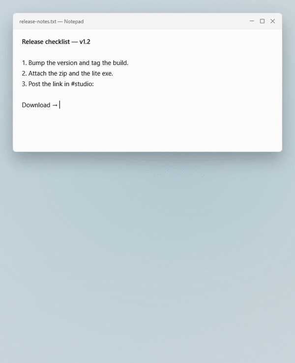
  </picture>
</p>
<p align="center"><sub><kbd>Win</kbd> + <kbd>V</kbd> in a text editor. The panel opens under the caret, <kbd>↓</kbd> walks back through history, <kbd>Tab</kbd> changes category, <kbd>Enter</kbd> puts the link into the text.</sub></p>

<br>

## Why SweaxClip

The clipboard history built into Windows keeps the last 25 items and clears them every time you restart. The address you copied last week, the code snippet from last month and the screenshot of an invoice from the spring are gone.

SweaxClip keeps everything you copy — text, links, code, colours, images, screenshots and files — in an archive on your own disk that survives restarts, updates and years. It opens on the same shortcut, in the same place, and waits in the tray using about 10 MB of memory.

<table>
<tr>
<td width="33%" valign="top">
<picture><source media="(prefers-color-scheme: dark)" srcset="docs/art/feature-where-dark.svg"></picture>
<h3>Opens where you type</h3>
<p>Under your text cursor — in Chrome, Edge, Word, VS Code and anything else that reports its caret — or above the taskbar when there is none. The clip you pick is pasted into the window you were typing in.</p>
</td>
<td width="33%" valign="top">
<picture><source media="(prefers-color-scheme: dark)" srcset="docs/art/feature-history-dark.svg"></picture>
<h3>Never forgets</h3>
<p>No limit and no expiry. Copy the same thing twice and it moves to the top instead of appearing again. Pin what you reuse; deleted clips wait in Trash until you empty it.</p>
</td>
<td width="33%" valign="top">
<picture><source media="(prefers-color-scheme: dark)" srcset="docs/art/feature-ocr-dark.svg"></picture>
<h3>Reads your screenshots</h3>
<p>Images are read by the OCR engine built into Windows, on your PC. Type a word that appears in a screenshot and the screenshot comes up, with the word marked.</p>
</td>
</tr>
<tr>
<td width="33%" valign="top">
<picture><source media="(prefers-color-scheme: dark)" srcset="docs/art/feature-kinds-dark.svg"></picture>
<h3>Sorted as it arrives</h3>
<p>Text, links, images, screenshots, files, code and colours each get a category and a colour of their own. <kbd>Tab</kbd> moves between them without leaving the keyboard.</p>
</td>
<td width="33%" valign="top">
<picture><source media="(prefers-color-scheme: dark)" srcset="docs/art/feature-private-dark.svg"></picture>
<h3>Stays on your PC</h3>
<p>No account, no telemetry, no network requests at all. Copies that password managers mark as private are never stored, and capture can be paused from the tray.</p>
</td>
<td width="33%" valign="top">
<picture><source media="(prefers-color-scheme: dark)" srcset="docs/art/feature-library-dark.svg"></picture>
<h3>A library for all of it</h3>
<p>Every clip you ever copied, laid out by day. Pick one up to see it whole: the full text, the image at full size, where it came from and how often you used it.</p>
</td>
</tr>
</table>

<br>

## The panel

Press <kbd>Win</kbd> + <kbd>V</kbd>. The panel is a timeline: the time each clip was copied runs down a rail on the left, and every clip shows its content — the text, the site of a link, the code with its colours, the colour itself, a strip of the picture.

The selected clip opens up. Text unfolds to seven lines, a picture grows into a real preview, code shows eight lines, a link shows its full address and the page it came from, and you see which app it was copied in. Everything in the panel moves on springs, so walking through history with the arrow keys is one continuous motion rather than a series of jumps.

<table>
<tr>
<td width="33%"><picture><source media="(prefers-color-scheme: dark)" srcset="docs/shots/en/panel-images-dark.png">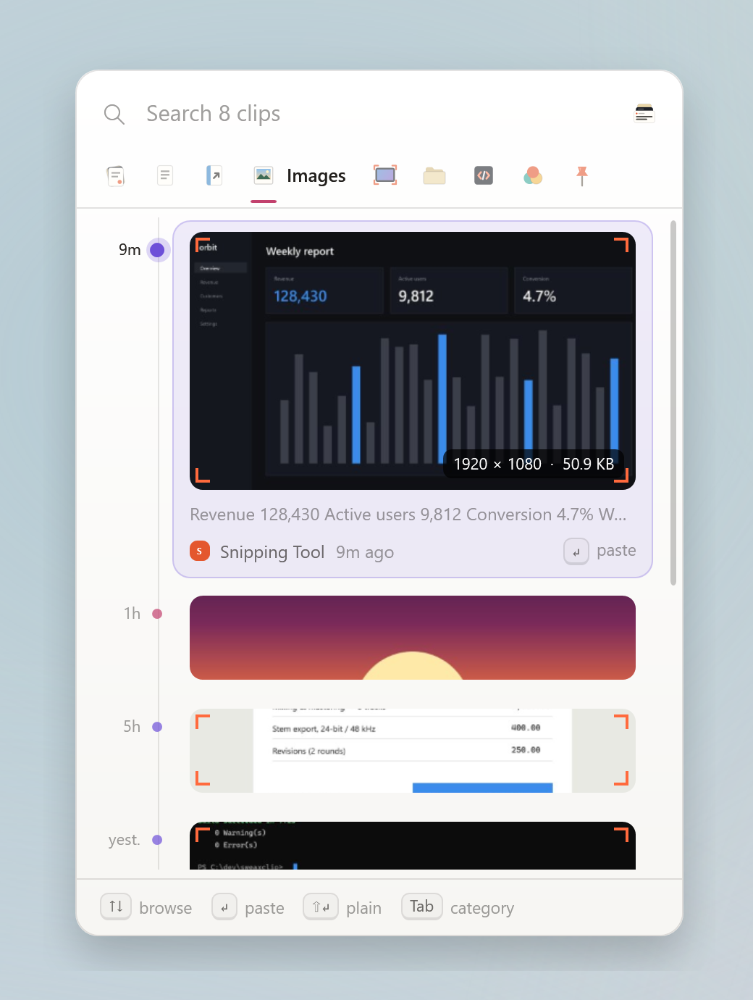</picture></td>
<td width="33%"><picture><source media="(prefers-color-scheme: dark)" srcset="docs/shots/en/panel-code-dark.png">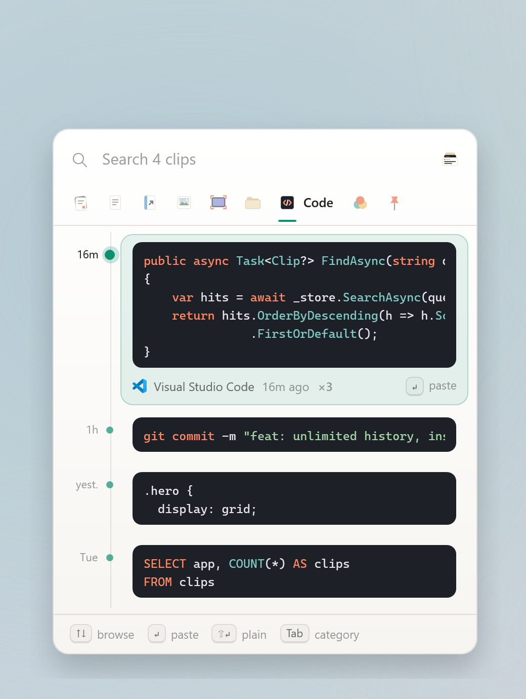</picture></td>
<td width="33%"><picture><source media="(prefers-color-scheme: dark)" srcset="docs/shots/en/panel-links-dark.png">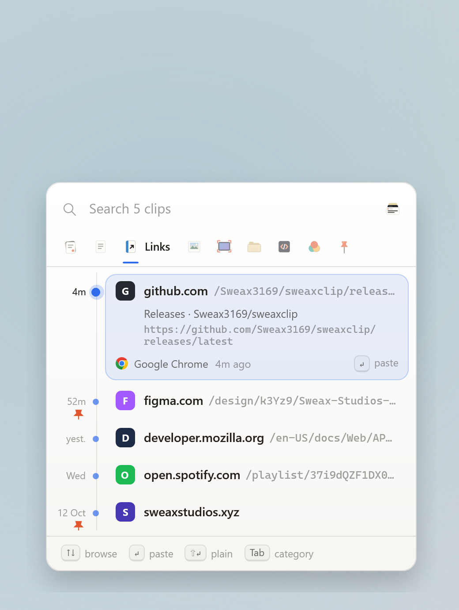</picture></td>
</tr>
<tr>
<td align="center"><sub><b>Images.</b> The open clip grows into a preview, with the text read from it.</sub></td>
<td align="center"><sub><b>Code.</b> Syntax colours, line breaks and indentation kept.</sub></td>
<td align="center"><sub><b>Links.</b> The site, the path, and the page it was copied from.</sub></td>
</tr>
</table>

**Where it opens.** Exactly where Windows opens its own clipboard panel: below the text cursor, or above it when the cursor is near the bottom of the screen, and centred above the taskbar when no cursor can be found. Start and Windows Search are drawn in a layer above every app, so if one of them is open when you press the shortcut, SweaxClip closes it, opens above the taskbar, and pastes your pick into Search.

**Keys**

| Keys | In the panel |
| --- | --- |
| <kbd>Win</kbd> <kbd>V</kbd> | Open or close |
| <kbd>↑</kbd> <kbd>↓</kbd> · <kbd>PgUp</kbd> <kbd>PgDn</kbd> · <kbd>Home</kbd> <kbd>End</kbd> | Walk through history |
| <kbd>Enter</kbd> or click | Paste into the app you were typing in |
| <kbd>Shift</kbd> <kbd>Enter</kbd> | Paste as plain text, without formatting |
| Hold <kbd>Alt</kbd>, press <kbd>1</kbd>–<kbd>9</kbd> | Paste one of the nine newest clips — the numbers appear on the rail while <kbd>Alt</kbd> is held |
| <kbd>Tab</kbd> · <kbd>Shift</kbd> <kbd>Tab</kbd> · <kbd>←</kbd> <kbd>→</kbd> | Next or previous category |
| <kbd>Ctrl</kbd> <kbd>1</kbd>–<kbd>9</kbd> | Jump to a category |
| Start typing | Search everything, including the text inside images |
| <kbd>Ctrl</kbd> <kbd>P</kbd> | Pin or unpin |
| <kbd>Delete</kbd> | Move to Trash |
| <kbd>Ctrl</kbd> <kbd>C</kbd> | Copy without pasting |
| <kbd>Ctrl</kbd> <kbd>O</kbd> | Open the link, file or image |
| <kbd>Ctrl</kbd> <kbd>E</kbd> | Show the clip in the library |
| <kbd>Esc</kbd> | Clear the search, then close |

The shortcut can be <kbd>Ctrl</kbd> <kbd>Shift</kbd> <kbd>V</kbd> or <kbd>Ctrl</kbd> <kbd>Alt</kbd> <kbd>V</kbd> instead (Settings → General). Hovering a clip shows pin and delete buttons; right-click has every action.

<br>

## Search inside screenshots

<table>
<tr>
<td width="46%" valign="top">
<picture>
  <source media="(prefers-color-scheme: dark)" srcset="docs/media/search-en-dark.gif">
  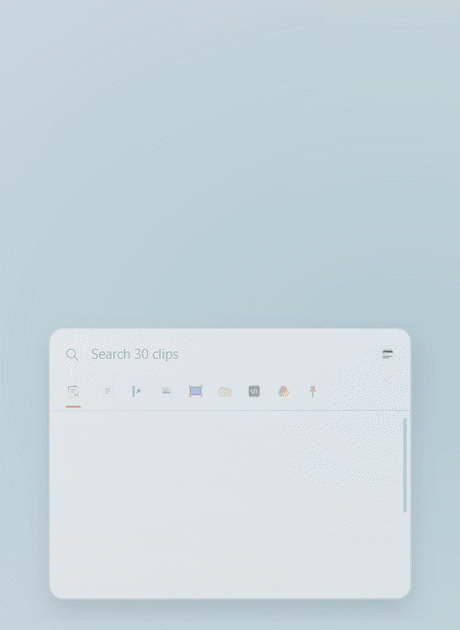
</picture>
</td>
<td valign="top">

Every image and screenshot is read once, in the background, by the OCR engine that ships with Windows (`Windows.Media.Ocr`). The text it finds is stored with the image and searched like any other text.

- Type a few letters of any word. The panel narrows as you type and glides to the size of what is left.
- Matches are marked inside the clip — in the text, the address of a link, a file name, or the text read from a picture.
- Case, accents and Turkish letters don't matter: `fatura`, `FATURA` and `faturá` find the same clips, and `isik` finds `ışık`.
- The index is built from three-letter pieces (FTS5 trigrams), so part of a word is enough.
- OCR runs on your PC in the languages installed in Windows. Nothing is uploaded.

</td>
</tr>
</table>

<br>

## Copy text from anywhere on screen

<picture>
  <source media="(prefers-color-scheme: dark)" srcset="docs/shots/en/grab-dark.png">
  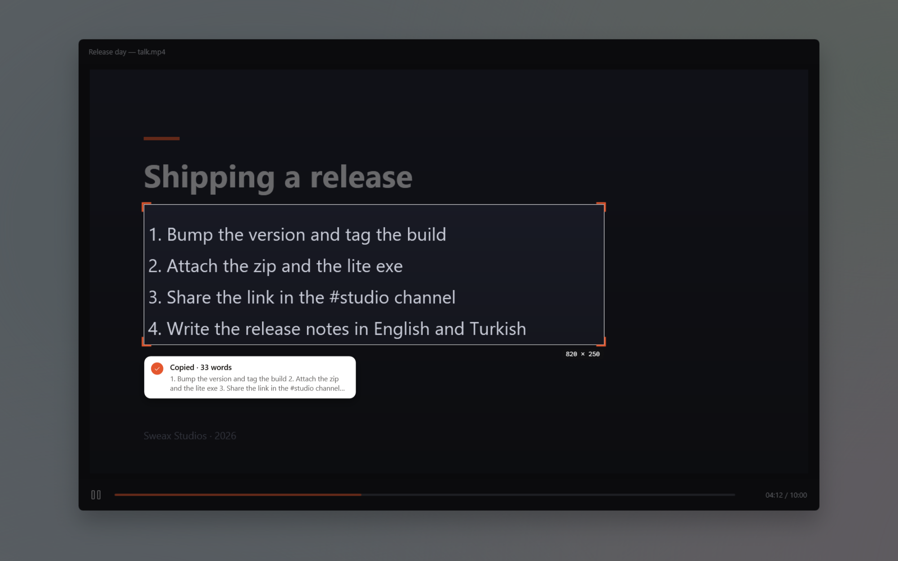
</picture>

Some text can't be selected: words inside a picture, a paused video, a slide someone is sharing, an error dialog, a game. Press <kbd>Win</kbd> + <kbd>Shift</kbd> + <kbd>T</kbd>, drag over it, and it is on your clipboard.

- **The screen freezes** under a dim layer the moment you press the shortcut, so a video or an animation can't move away while you select.
- **Drag a box over the text.** Its size in pixels follows the corner. Let go and the text is read and copied, and a note beside the box shows how many words and the first of them.
- **Every monitor** works the same. <kbd>Esc</kbd> or a right-click cancels.
- **It lands in your history** too, like anything else you copy.
- **Read on your PC** by the Windows OCR engine, in the languages installed in Windows. Before reading, SweaxClip turns light-on-dark text into dark-on-light and scales it to the size the engine reads best.
- **Any shortcut you like:** Settings → General → *Copy text from screen*. Click the shortcut and press the keys you want; the feature can be turned off there too. It is also in the tray menu, and `SweaxClip.exe --grab` starts it from a script or a macro key.

> [!NOTE]
> The engine reads sentences and interface text very well. In code it can miss lone symbols such as `=` or braces, so look over code before you run it.

<br>

## The library

Everything you ever copied, on one desk. Open it from the tray icon, from the panel with <kbd>Ctrl</kbd> <kbd>E</kbd>, or by starting `SweaxClip.exe` again.

<picture>
  <source media="(prefers-color-scheme: dark)" srcset="docs/shots/en/hero-dark.png">
  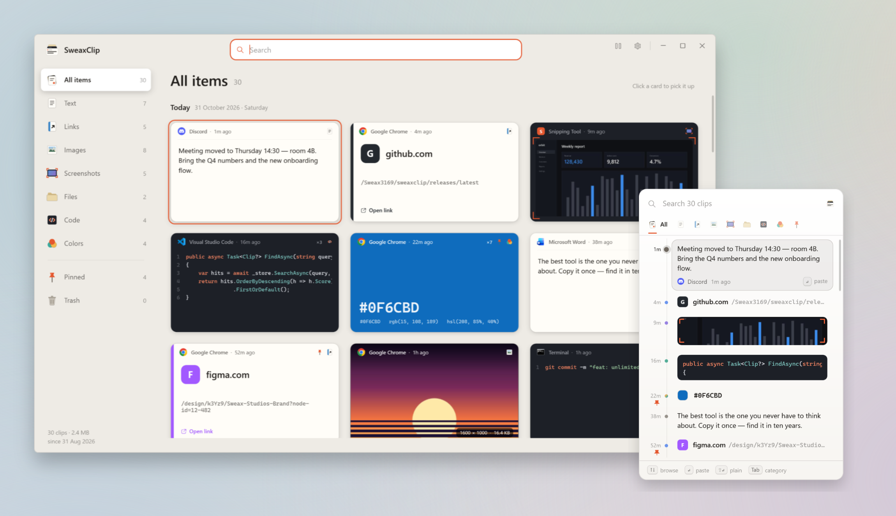
</picture>

Each clip is drawn as the thing it is: text on a sheet of paper, a link in its site's colour, code on slate, a colour as the colour itself, an image as a print, a screenshot in a frame with crop marks, copied files in a folder. Click any of them to pick it up.

<table>
<tr>
<td width="50%">
<picture><source media="(prefers-color-scheme: dark)" srcset="docs/shots/en/library-lightbox-dark.png">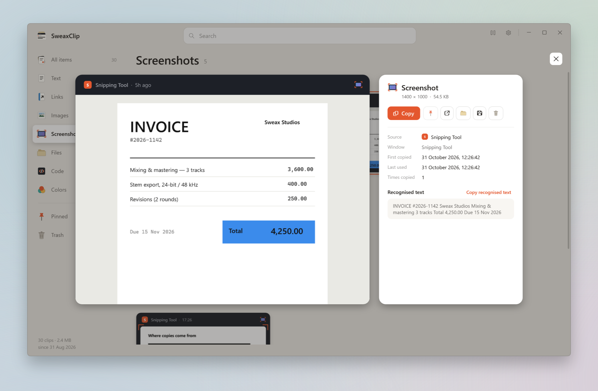</picture>
<p align="center"><sub>A screenshot picked up: full size, where it came from, the text read from it</sub></p>
</td>
<td width="50%">
<picture><source media="(prefers-color-scheme: dark)" srcset="docs/shots/en/library-code-dark.png">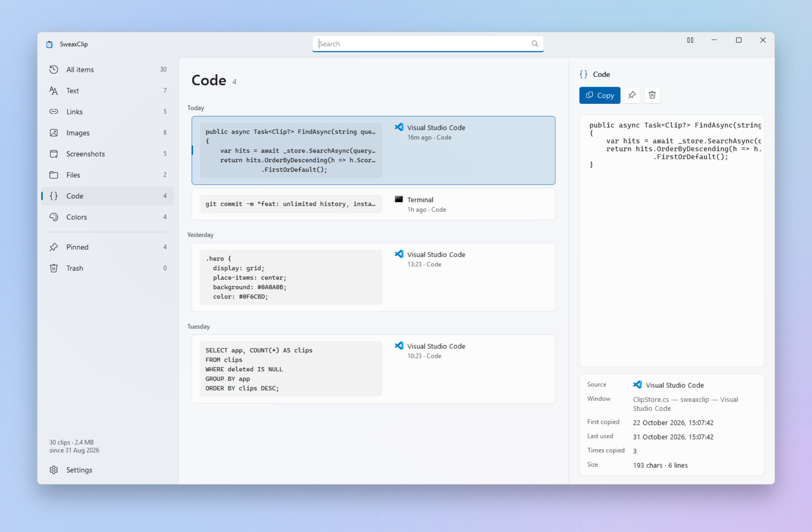</picture>
<p align="center"><sub>Code keeps its formatting and colours</sub></p>
</td>
</tr>
<tr>
<td width="50%">
<picture><source media="(prefers-color-scheme: dark)" srcset="docs/shots/en/library-screenshots-dark.png">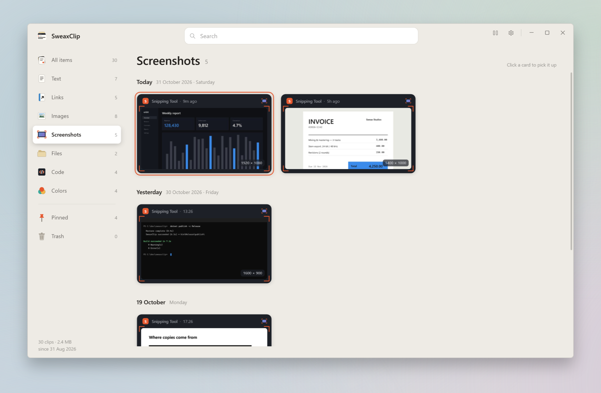</picture>
<p align="center"><sub>Every screenshot you took, grouped by day</sub></p>
</td>
<td width="50%">
<picture><source media="(prefers-color-scheme: dark)" srcset="docs/shots/en/library-settings-dark.png">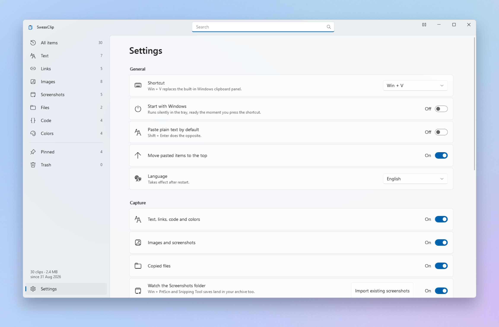</picture>
<p align="center"><sub>Settings</sub></p>
</td>
</tr>
</table>

<details>
<summary><b>Library keys</b></summary>
<br>

| Keys | In the library |
| --- | --- |
| Click · <kbd>Space</kbd> | Pick up the selected clip, or put it back |
| Arrow keys · <kbd>PgUp</kbd> <kbd>PgDn</kbd> | Move between clips |
| <kbd>Enter</kbd> · <kbd>Shift</kbd> <kbd>Enter</kbd> | Copy · copy as plain text |
| <kbd>Ctrl</kbd> <kbd>Tab</kbd> · <kbd>Ctrl</kbd> <kbd>1</kbd>–<kbd>9</kbd> · <kbd>Ctrl</kbd> <kbd>0</kbd> | Next category · jump to a category · Trash |
| <kbd>Ctrl</kbd> <kbd>F</kbd> | Search |
| <kbd>Ctrl</kbd> <kbd>P</kbd> · <kbd>Delete</kbd> | Pin · move to Trash (in Trash: delete for good) |
| <kbd>Ctrl</kbd> <kbd>O</kbd> | Open the link, file or image |
| <kbd>Ctrl</kbd> <kbd>,</kbd> | Settings |
| <kbd>Esc</kbd> | Put the clip back, clear the search, close |

</details>

<br>

## Make it yours

**Settings → Appearance** changes the whole app at once, without a restart.

<picture>
  <source media="(prefers-color-scheme: dark)" srcset="docs/shots/en/palettes-dark.png">
  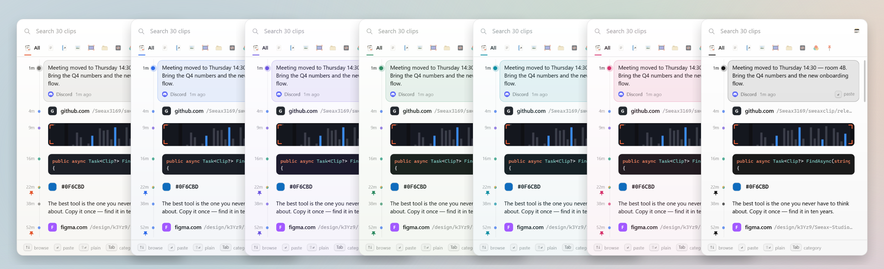
</picture>
<p align="center"><sub>Ember · Graphite · Midnight · Sage · Ocean · Rose · Mono — each in a light and a dark version</sub></p>

<table>
<tr>
<td width="50%"><picture><source media="(prefers-color-scheme: dark)" srcset="docs/shots/en/panel-all-dark.png">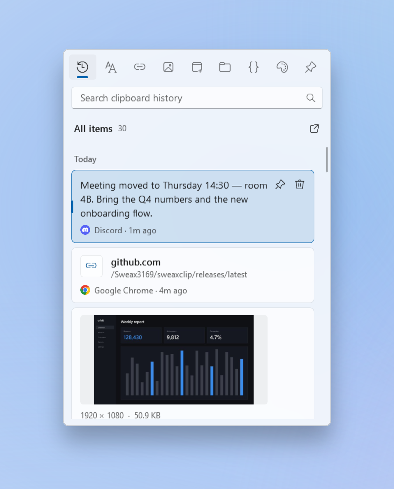</picture></td>
<td width="50%"><picture><source media="(prefers-color-scheme: dark)" srcset="docs/shots/en/panel-deck-dark.png">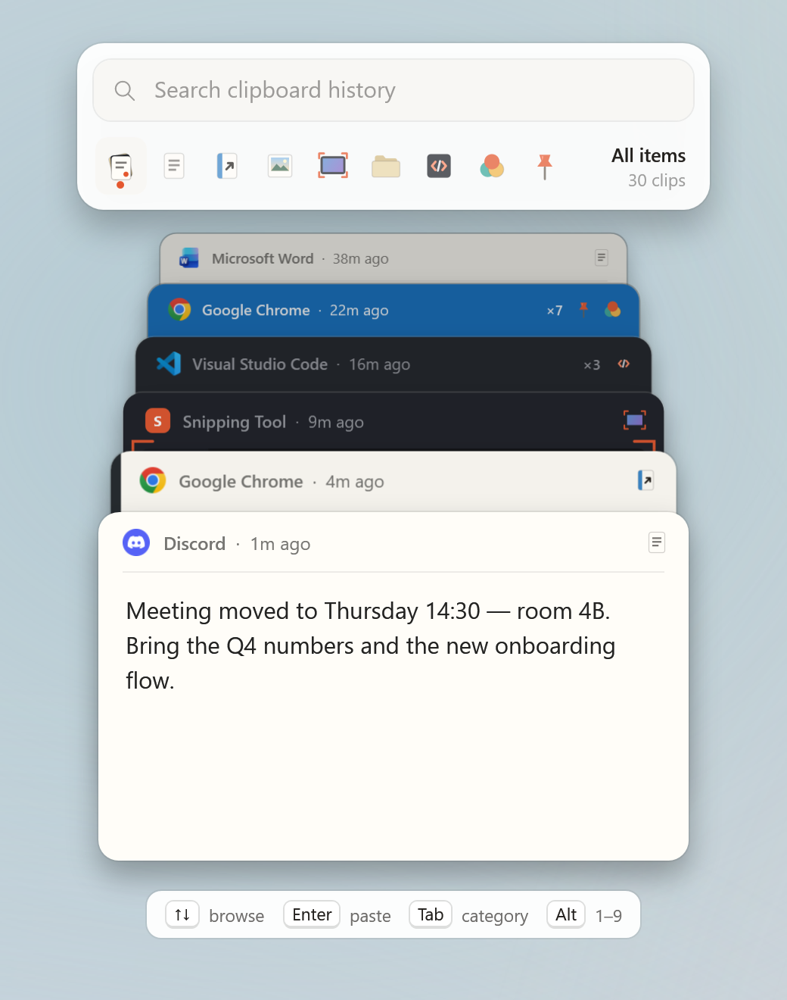</picture></td>
</tr>
<tr>
<td align="center"><sub><b>Timeline</b> (default) — many clips at once; the selected one opens up</sub></td>
<td align="center"><sub><b>Deck</b> — one card in front, older clips stacked behind it with only their headers showing</sub></td>
</tr>
</table>

- **Panel style.** Timeline or Deck. Both open in the same place, use the same keys and move on the same springs.
- **Theme.** Follow Windows, or stay light or dark.
- **Colours.** Seven palettes. Each one recolours the desk, the surfaces, the accent and the materials of the cards — paper, folders and slate — in both light and dark.

<br>

## Compared with Windows

| | Windows clipboard history | SweaxClip |
| --- | :---: | :---: |
| Items kept | 25 | Unlimited |
| After a restart | Cleared, except pinned items | Kept |
| Images | Up to 4 MB | Any size, lossless |
| Search | — | Full text, including text inside images |
| Categories | — | 7, plus Pinned and Trash |
| Copied files | — | Kept, pasted back as files |
| Where each clip came from | — | App, window title, time, number of uses |
| Screenshots folder | — | Watched; existing screenshots imported |
| Backups | — | Daily snapshot, `.zip` export |

<br>

## Under the hood

<picture>
  <source media="(prefers-color-scheme: dark)" srcset="docs/art/architecture-dark.svg">
  
</picture>

- **Capture.** SweaxClip registers with `AddClipboardFormatListener`, so Windows tells it when something is copied — there is no polling. It reads the clipboard formats itself: Unicode text, HTML and RTF, PNG and bitmap data, and file lists. Copies carrying `ExcludeClipboardContentFromMonitorProcessing`, or `CanIncludeInClipboardHistory` set to 0 — the flags password managers use — are skipped.
- **Storage.** One SQLite database in WAL mode with `synchronous=FULL`, so a clip that has been written survives a power cut. Images are saved once, losslessly, in files named by their SHA-256 hash; copying the same picture twice stores it once.
- **Search.** An FTS5 index with the trigram tokenizer covers the clip text, the text read from images and the names of copied files. Text is normalised before it is indexed: lower case, accents removed, Turkish letters folded.
- **OCR.** A background queue reads new images with `Windows.Media.Ocr` and stores the text next to the clip.
- **The shortcut.** A low-level keyboard hook on its own thread receives <kbd>Win</kbd> + <kbd>V</kbd> before Windows does, so no Windows setting is changed. The text cursor is found with `GetGUIThreadInfo`, then through the accessibility caret (`OBJID_CARET`) for browsers and editors that draw their own.
- **Pasting.** The clip goes back on the clipboard in all its formats, focus returns to the window you were typing in, and SweaxClip sends <kbd>Ctrl</kbd> + <kbd>V</kbd>.
- **Resources.** In the tray SweaxClip uses about 8–12 MB of memory and no CPU. When the panel closes, the memory it used is handed back to Windows.
- **Text from screen.** Each monitor is captured with GDI before the dim layer appears. The selection is turned grey, inverted when it is mostly dark, contrast-stretched and scaled so its lines are about 36 pixels tall, then read with `Windows.Media.Ocr`.
- **Backups.** Every day the database is copied with `VACUUM INTO`; the last seven days and one copy per month are kept.

<details>
<summary><b>What is in the data folder</b></summary>
<br>

```
%LOCALAPPDATA%\SweaxClip\
├── sweaxclip.db     clips and the search index (SQLite, WAL)
├── blobs\           images, each stored once, named by SHA-256
├── thumbs\          small previews for the panel and the library
├── backups\         daily database snapshots
├── logs\            a short log for troubleshooting
└── settings.json
```

To keep the archive somewhere else — another drive, a synced folder, a USB stick — create an empty folder named `sweaxclip-data` next to `SweaxClip.exe` before the first start. SweaxClip then runs in portable mode and keeps everything there.

</details>

<br>

## Privacy

SweaxClip makes no network requests. There is no account, no analytics, no update check and no cloud sync; everything it stores stays in the data folder above.

- Password managers such as KeePass, KeePassXC, 1Password and Bitwarden mark their copies as private. SweaxClip skips them.
- Apps can be ignored by name in **Settings → Capture**; nothing copied in them is stored.
- Capture can be paused from the tray icon or the library's title bar, and the panel shows when it is paused.
- Deleted clips go to Trash. Emptying Trash removes the clips and their image files from disk.

<br>

## Install

1. Download [`SweaxClip-win-x64.zip`](https://github.com/Sweax3169/sweaxclip/releases/latest/download/SweaxClip-win-x64.zip) and extract it anywhere.
2. Run `SweaxClip.exe`. It copies itself to `%LOCALAPPDATA%\Programs\SweaxClip`, starts with Windows and adds a Start menu entry.
3. Press <kbd>Win</kbd> + <kbd>V</kbd>.

On the first start, the screenshots already in your *Pictures\Screenshots* folder are added to the archive.

If you already have the [.NET 9 Desktop Runtime](https://dotnet.microsoft.com/download/dotnet/9.0), [`SweaxClip-lite.exe`](https://github.com/Sweax3169/sweaxclip/releases/latest/download/SweaxClip-lite.exe) is the same app as a much smaller download.

> [!NOTE]
> The executable is not code-signed yet, so Windows SmartScreen may show a warning. Choose **More info → Run anyway**. Every release is built from this repository by [GitHub Actions](.github/workflows/build.yml) and lists SHA-256 checksums in `SHA256SUMS.txt`.

**Requirements:** Windows 10 (version 2004) or Windows 11, 64-bit.

**Updating:** quit SweaxClip from the tray icon, then run the new `SweaxClip.exe`. Your history is kept.

<br>

## Command line

| Command | Effect |
| --- | --- |
| `SweaxClip.exe` | Start, or open the library if SweaxClip is already running |
| `SweaxClip.exe --background` | Start in the tray without opening a window |
| `SweaxClip.exe --toggle` | Open or close the panel — for mouse buttons, macro keys and Stream Deck |
| `SweaxClip.exe --grab` | Copy text from screen, the same as its shortcut |
| `SweaxClip.exe --quit` | Exit the running instance |

**Macro keys.** Record a key combination such as <kbd>Ctrl</kbd> + <kbd>Alt</kbd> + <kbd>F9</kbd> on your keyboard's macro key, then click a shortcut in Settings → General and press the macro key. Keys sent by macro software count too, and F13–F24, Pause and Scroll Lock work on their own.

<br>

## Building from source

Requires the [.NET 9 SDK](https://dotnet.microsoft.com/download/dotnet/9.0) on Windows.

```powershell
git clone https://github.com/Sweax3169/sweaxclip
cd sweaxclip
dotnet run --project src/SweaxClip -- --demo
```

`--demo` opens the library on a temporary archive filled with sample data, so you can try everything without touching your own history. Every screenshot and animation in this README is rendered from that sample data by [`tools/render-media.ps1`](tools/render-media.ps1): the app films itself, one spring step per frame, so what you see here is exactly what the app does.

To build the release executable:

```powershell
dotnet publish src/SweaxClip -c Release -r win-x64 --self-contained -p:PublishSingleFile=true -p:IncludeNativeLibrariesForSelfExtract=true -p:PublishReadyToRun=true -o publish
```

<details>
<summary><b>Project layout</b></summary>
<br>

```
src/SweaxClip/
├── App.xaml.cs          start-up, single instance, tray, shortcut, install
├── Core/
│   ├── ClipboardReader  clipboard formats, privacy flags
│   ├── CapturePipeline  sorts each copy (text, link, code, colour, image, files), removes duplicates
│   ├── ClipStore        SQLite archive, FTS5 search, Trash, backups
│   ├── OcrService       Windows OCR queue
│   ├── KeyboardHook     Win + V on its own thread
│   └── Paster           puts a clip back on the clipboard and pastes it
├── UI/
│   ├── QuickPanel       the Win + V timeline
│   ├── PanelRows.xaml   how each kind of clip looks in the panel
│   ├── Motion           springs, reveal and grow
│   ├── LibraryWindow    the desk and the lightbox
│   ├── Cards.xaml       each kind of clip as its own card
│   ├── TextGrabber      copy text from screen: frozen screen, selection, note
│   └── CaretLocator     where the text cursor is
└── Dev/                 sample archive and the README renderer
```

</details>

<br>

## FAQ

<details>
<summary><b>Does SweaxClip turn off the Windows clipboard history?</b></summary>
<br>
No Windows setting is changed. SweaxClip receives the <kbd>Win</kbd> + <kbd>V</kbd> key press before Windows does. If you choose another shortcut in Settings, <kbd>Win</kbd> + <kbd>V</kbd> opens the Windows panel again.
</details>

<details>
<summary><b>How much disk space does it use?</b></summary>
<br>
Text takes very little — tens of thousands of clips fit in tens of megabytes, search index included. Images take most of the space; the library shows the total in its bottom-left corner. Clips you delete go to Trash and are removed from disk only when you empty it.
</details>

<details>
<summary><b>The panel opened above the taskbar instead of under my cursor.</b></summary>
<br>
Some apps draw their own text cursor and don't tell Windows where it is. When SweaxClip can't find the cursor it opens above the taskbar, as the Windows panel does, and the paste still goes into the app you were typing in.
</details>

<details>
<summary><b>Pasting does not work in some apps.</b></summary>
<br>
SweaxClip pastes by sending <kbd>Ctrl</kbd> + <kbd>V</kbd>, and Windows does not let apps send keys to programs running as administrator. Run SweaxClip as administrator too, or press <kbd>Ctrl</kbd> + <kbd>C</kbd> in the panel and paste yourself.
</details>

<details>
<summary><b>Which languages can it read in screenshots?</b></summary>
<br>
The languages whose OCR component is installed in Windows — normally the languages you have added to Windows. More can be added in Settings → Time &amp; language → Language &amp; region.
</details>

<details>
<summary><b>How do I move my history to another PC?</b></summary>
<br>
Use <b>Settings → Storage → Export archive</b>, then extract the <code>.zip</code> into <code>%LOCALAPPDATA%\SweaxClip</code> on the new PC before starting SweaxClip there.
</details>

<details>
<summary><b>How do I uninstall it?</b></summary>
<br>
Turn off <b>Start with Windows</b> in Settings, then right-click the tray icon and choose <b>Quit</b>. Delete <code>%LOCALAPPDATA%\Programs\SweaxClip</code> (the app) and, if you no longer want your history, <code>%LOCALAPPDATA%\SweaxClip</code>.
</details>

<br>

## License

[MIT](LICENSE) © 2026 Sweax Studios. Third-party components are listed in [THIRD_PARTY_NOTICES.md](THIRD_PARTY_NOTICES.md).

<br>

<p align="center">
  
  <br>
  <sub>Made by <a href="https://github.com/Sweax3169">Sweax</a> · <a href="https://sweaxstudios.xyz">Sweax Studios</a>, Türkiye</sub>
</p>
