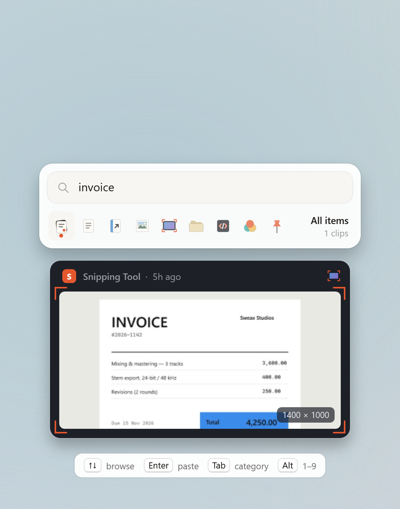

<p align="center">
  
</p>

<h1 align="center">SweaxClip</h1>

<p align="center">
  A permanent, searchable clipboard history for Windows.<br>
  Press <kbd>Win</kbd> + <kbd>V</kbd> and everything you have copied is there.
</p>

<p align="center">
  <a href="https://github.com/Sweax3169/sweaxclip/releases/latest/download/SweaxClip-win-x64.zip"><b>Download for Windows</b></a>
  &nbsp;·&nbsp;
  <a href="https://sweax3169.github.io/sweaxclip/">Website</a>
  &nbsp;·&nbsp;
  <a href="README.tr.md">Türkçe</a>
</p>

<p align="center">
  <a href="https://github.com/Sweax3169/sweaxclip/releases/latest"></a>
  <a href="https://github.com/Sweax3169/sweaxclip/releases"></a>
  <a href="https://github.com/Sweax3169/sweaxclip/actions/workflows/build.yml"></a>
  
  <a href="LICENSE"></a>
</p>

<br>

<picture>
  <source media="(prefers-color-scheme: dark)" srcset="docs/shots/en/hero-dark.png">
  
</picture>

## Why SweaxClip

The clipboard history built into Windows keeps the last 25 items and clears them every time you restart. SweaxClip keeps everything you copy — text, links, code, colours, images, screenshots and files — in a local archive that survives restarts, and opens on the same shortcut.

- **Replaces <kbd>Win</kbd> + <kbd>V</kbd>.** Your history is dealt as a deck of cards exactly where Windows opens its own panel — under your text cursor (also in Chrome, Edge and other apps that report the cursor to accessibility tools), or above the taskbar — and the card you pick is thrown into the app you were typing in.
- **Unlimited history.** Nothing is removed automatically. Copy the same thing twice and it moves to the top instead of appearing again.
- **Sorted for you.** Text, links, images, screenshots, files, code and colours each get their own category.
- **Search inside screenshots.** Images are read with the OCR engine built into Windows, so a word in a screenshot finds the screenshot.
- **A library for everything else.** Browse by category, view images as a gallery, and see where each item came from and how often you used it.
- **Every clip looks like what it is.** Text is a sheet of paper, a link carries its site's colour, code sits on slate with its syntax coloured, a colour is the colour itself, a screenshot sits in a bezel with crop marks and files arrive in a manila folder. Follows your light or dark theme.
- **Light on resources.** Around 10–12 MB of memory while it waits in the tray, and no CPU use until you copy something.
- **Private.** Everything stays on your PC. Copies that password managers mark as private are skipped.

## The deck

The newest clip is the card in front; older ones stack behind it, each showing just enough to recognise it. Every card moves on springs — flipping through history, dealing a category, throwing a card at the cursor or dropping it in the bin all share one physical feel.

<table>
<tr>
<td width="44%" valign="top">
<picture>
  <source media="(prefers-color-scheme: dark)" srcset="docs/media/quick-panel-en-dark.gif">
  
</picture>
</td>
<td valign="top">

| Shortcut | Action |
| --- | --- |
| <kbd>Win</kbd> <kbd>V</kbd> | Open or close the panel |
| <kbd>↑</kbd> <kbd>↓</kbd> | Select an item |
| <kbd>Enter</kbd> | Paste |
| <kbd>Shift</kbd> <kbd>Enter</kbd> | Paste as plain text |
| Hold <kbd>Alt</kbd>, press <kbd>1</kbd>–<kbd>9</kbd> | Paste a numbered item |
| <kbd>Tab</kbd> or <kbd>←</kbd> <kbd>→</kbd> | Switch category |
| <kbd>Ctrl</kbd> <kbd>P</kbd> | Pin or unpin |
| <kbd>Delete</kbd> | Move to trash |
| <kbd>Ctrl</kbd> <kbd>C</kbd> | Copy without pasting |
| <kbd>Ctrl</kbd> <kbd>O</kbd> | Open the link, file or image |
| <kbd>Ctrl</kbd> <kbd>E</kbd> | Show in the library |
| Start typing | Search |

The shortcut can be changed to <kbd>Ctrl</kbd> <kbd>Shift</kbd> <kbd>V</kbd> or <kbd>Ctrl</kbd> <kbd>Alt</kbd> <kbd>V</kbd> in Settings.

</td>
</tr>
</table>

<table>
<tr>
<td width="33%">
<picture>
  <source media="(prefers-color-scheme: dark)" srcset="docs/shots/en/panel-images-dark.png">
  
</picture>
</td>
<td width="33%">
<picture>
  <source media="(prefers-color-scheme: dark)" srcset="docs/shots/en/panel-code-dark.png">
  
</picture>
</td>
<td width="33%">
<picture>
  <source media="(prefers-color-scheme: dark)" srcset="docs/shots/en/panel-search-dark.png">
  
</picture>
</td>
</tr>
<tr>
<td align="center"><sub>Images</sub></td>
<td align="center"><sub>Code</sub></td>
<td align="center"><sub>A word found inside a screenshot</sub></td>
</tr>
</table>

## The library

Everything you ever copied lies on a desk, grouped by day. Click a card to pick it up: it opens full size, with where it came from, how often you used it and the text found in it.

<table>
<tr>
<td width="50%">
<picture>
  <source media="(prefers-color-scheme: dark)" srcset="docs/shots/en/library-lightbox-dark.png">
  
</picture>
<p align="center"><sub>A screenshot picked up, with the text found in it</sub></p>
</td>
<td width="50%">
<picture>
  <source media="(prefers-color-scheme: dark)" srcset="docs/shots/en/library-code-dark.png">
  
</picture>
<p align="center"><sub>Code keeps its formatting and colours</sub></p>
</td>
</tr>
<tr>
<td width="50%">
<picture>
  <source media="(prefers-color-scheme: dark)" srcset="docs/shots/en/library-screenshots-dark.png">
  
</picture>
<p align="center"><sub>Every screenshot you took, by day</sub></p>
</td>
<td width="50%">
<picture>
  <source media="(prefers-color-scheme: dark)" srcset="docs/shots/en/library-settings-dark.png">
  
</picture>
<p align="center"><sub>Settings</sub></p>
</td>
</tr>
</table>

## Install

1. Download [`SweaxClip-win-x64.zip`](https://github.com/Sweax3169/sweaxclip/releases/latest/download/SweaxClip-win-x64.zip) and extract it.
2. Run `SweaxClip.exe`. It installs itself to `%LOCALAPPDATA%\Programs\SweaxClip`, starts with Windows and adds a Start menu entry.
3. Press <kbd>Win</kbd> + <kbd>V</kbd>.

On first start, existing screenshots in your *Pictures\Screenshots* folder are added to the archive.

If you already have the [.NET 9 Desktop Runtime](https://dotnet.microsoft.com/download/dotnet/9.0), [`SweaxClip-lite.exe`](https://github.com/Sweax3169/sweaxclip/releases/latest/download/SweaxClip-lite.exe) is a smaller download of the same app.

> [!NOTE]
> The executable is not code-signed yet, so Windows SmartScreen may show a warning. Choose **More info → Run anyway**. Releases are built from this repository by [GitHub Actions](.github/workflows/build.yml), and each release lists SHA-256 checksums.

**Requirements:** Windows 10 (version 2004) or Windows 11, 64-bit.

## How your history is kept

| | Windows clipboard history | SweaxClip |
| --- | :---: | :---: |
| Items kept | 25 | Unlimited |
| After a restart | Cleared, except pinned items | Kept |
| Images | Up to 4 MB | Any size, lossless |
| Search | — | Full text, including text in images |
| Categories | — | 7, plus Pinned and Trash |
| Copied files | — | Kept and pasted back as files |
| Backups | — | Daily, plus `.zip` export |

The archive is a single SQLite database (WAL journal, synchronous writes) plus image files named by their SHA-256 hash, stored in `%LOCALAPPDATA%\SweaxClip`. A copy of the database is saved every day; the last seven days and one copy per month are kept. **Settings → Storage** can export everything to one `.zip`.

To keep the archive somewhere else — another drive, a synced folder, a USB stick — create an empty folder named `sweaxclip-data` next to `SweaxClip.exe` before the first start.

## Privacy

SweaxClip makes no network requests: there is no account, telemetry or cloud sync. Text recognition uses the Windows OCR engine on your PC.

Password managers such as KeePass, KeePassXC, 1Password and Bitwarden mark their copies with the standard `ExcludeClipboardContentFromMonitorProcessing` and `CanIncludeInClipboardHistory` flags; SweaxClip skips those copies. You can also list apps to ignore, or pause capture from the tray icon.

## Command line

| Command | Effect |
| --- | --- |
| `SweaxClip.exe` | Start, or open the library if SweaxClip is already running |
| `SweaxClip.exe --background` | Start in the tray without opening a window |
| `SweaxClip.exe --toggle` | Open or close the quick panel — useful for mouse buttons and macro keys |
| `SweaxClip.exe --quit` | Exit the running instance |

## Building from source

Requires the [.NET 9 SDK](https://dotnet.microsoft.com/download/dotnet/9.0) on Windows.

```powershell
git clone https://github.com/Sweax3169/sweaxclip
cd sweaxclip
dotnet run --project src/SweaxClip -- --demo
```

`--demo` opens the library on a temporary archive filled with sample data, so you can try the app without touching your own history. `tools/render-media.ps1` regenerates every image in this README from that same sample data.

To build the release executable:

```powershell
dotnet publish src/SweaxClip -c Release -r win-x64 --self-contained -p:PublishSingleFile=true -p:IncludeNativeLibrariesForSelfExtract=true -p:PublishReadyToRun=true -o publish
```

## FAQ

<details>
<summary>Does SweaxClip turn off the Windows clipboard history?</summary>
<br>
No Windows setting is changed. SweaxClip receives the <kbd>Win</kbd> + <kbd>V</kbd> key press before Windows does. If you choose a different shortcut in Settings, <kbd>Win</kbd> + <kbd>V</kbd> opens the Windows panel again.
</details>

<details>
<summary>How much disk space does it use?</summary>
<br>
Text takes very little — tens of thousands of items fit in tens of megabytes, search index included. Images take most of the space; the library shows the total in the bottom-left corner. Items you delete go to Trash, which is only emptied when you choose to.
</details>

<details>
<summary>How do I move my history to another PC?</summary>
<br>
Use <b>Settings → Storage → Export archive</b>, then extract the <code>.zip</code> into <code>%LOCALAPPDATA%\SweaxClip</code> on the new PC before starting SweaxClip there.
</details>

<details>
<summary>Pasting does not work in some apps.</summary>
<br>
SweaxClip pastes by sending <kbd>Ctrl</kbd> + <kbd>V</kbd>. Windows does not allow apps to send keys to programs running as administrator. Run SweaxClip as administrator too, or press <kbd>Ctrl</kbd> + <kbd>C</kbd> in the panel and paste yourself.
</details>

<details>
<summary>How do I uninstall it?</summary>
<br>
Right-click the tray icon and choose <b>Quit</b>. Then delete <code>%LOCALAPPDATA%\Programs\SweaxClip</code> (the app) and, if you no longer want your history, <code>%LOCALAPPDATA%\SweaxClip</code>. Turn off <b>Start with Windows</b> in Settings first to remove the startup entry.
</details>

## License

[MIT](LICENSE) © 2026 Sweax Studios. Third-party components are listed in [THIRD_PARTY_NOTICES.md](THIRD_PARTY_NOTICES.md).
