<p align="center">
  <a href="https://github.com/Sweax3169/sweaxclip/releases/latest">
    
  </a>
</p>

<p align="center">
  <a href="https://github.com/Sweax3169/sweaxclip/releases/latest"></a>
  <a href="https://github.com/Sweax3169/sweaxclip/releases"></a>
  
  
  <a href="LICENSE"></a>
</p>

<p align="center">
  <b>English</b> &nbsp;·&nbsp; <a href="README.tr.md">Türkçe</a> &nbsp;·&nbsp; <a href="https://sweax3169.github.io/sweaxclip/">Website</a> &nbsp;·&nbsp; <a href="https://github.com/Sweax3169/sweaxclip/releases/latest"><b>Download</b></a>
</p>

<br>

<p align="center">
  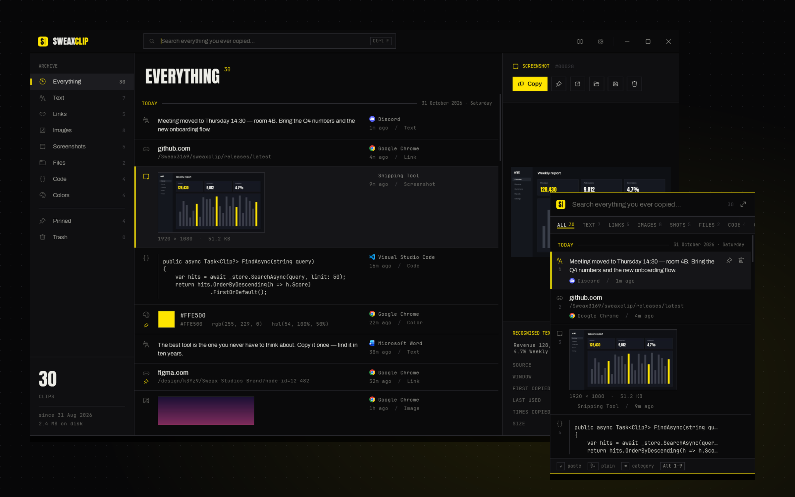
</p>

Windows keeps the last 25 things you copied and throws them away when you restart. **SweaxClip keeps every one** — text, links, code, colors, images, screenshots and files — in a local archive that survives reboots and years of use. Press <kbd>Win</kbd> + <kbd>V</kbd> and it is there, sorted and searchable.

<br>

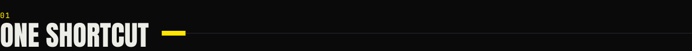

<table>
<tr>
<td width="46%" valign="top">

</td>
<td valign="top">

<kbd>Win</kbd> + <kbd>V</kbd> opens the quick panel next to your text cursor, with everything you copied on one timeline. Categories are one <kbd>Tab</kbd> away. Pick something and it is pasted straight into the app you were typing in.

| Key | Action |
| --- | --- |
| <kbd>Win</kbd> <kbd>V</kbd> | Open / close the panel |
| <kbd>↑</kbd> <kbd>↓</kbd> | Move through the timeline |
| <kbd>Enter</kbd> | Paste |
| <kbd>Shift</kbd> <kbd>Enter</kbd> | Paste as plain text |
| <kbd>Alt</kbd> <kbd>1</kbd>…<kbd>9</kbd> | Paste the numbered item |
| <kbd>Tab</kbd> · <kbd>←</kbd> <kbd>→</kbd> | Next / previous category |
| <kbd>Ctrl</kbd> <kbd>1</kbd>…<kbd>9</kbd> | Jump to a category |
| <kbd>Ctrl</kbd> <kbd>P</kbd> | Pin |
| <kbd>Del</kbd> | Move to trash |
| <kbd>Ctrl</kbd> <kbd>C</kbd> | Copy without pasting |
| <kbd>Ctrl</kbd> <kbd>O</kbd> | Open link / file / image |
| <kbd>Ctrl</kbd> <kbd>E</kbd> | Open in the library |
| Just type | Search |

</td>
</tr>
</table>

The shortcut can be changed to <kbd>Ctrl</kbd> <kbd>Shift</kbd> <kbd>V</kbd> or <kbd>Ctrl</kbd> <kbd>Alt</kbd> <kbd>V</kbd> in Settings. `SweaxClip.exe --toggle` opens the panel from anywhere — a mouse button, a macro key, a Stream Deck.

<br>

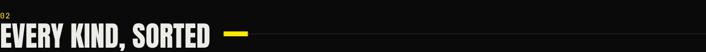

Every copy is filed the moment it arrives.

<table>
<tr>
<td width="33%">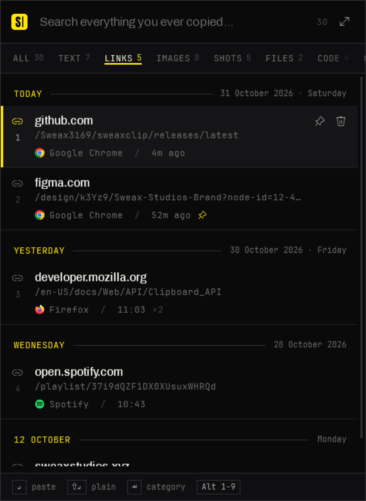</td>
<td width="33%">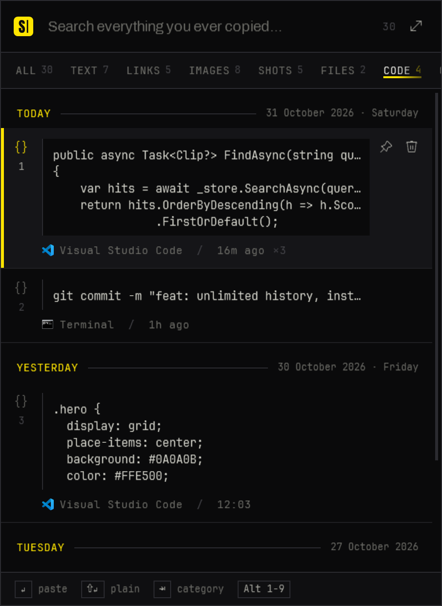</td>
<td width="33%">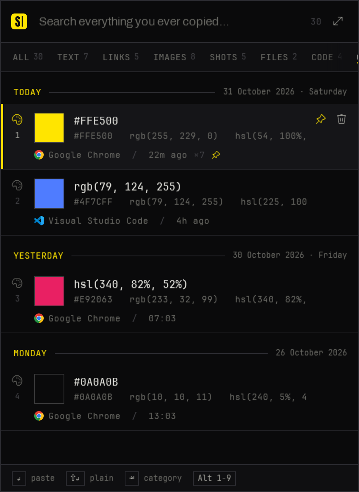</td>
</tr>
</table>

| Category | What lands there |
| --- | --- |
| **Everything** | One timeline, newest first, grouped by day |
| **Text** | Plain and rich text — Word and browser formatting is kept and pasted back |
| **Links** | A single URL, shown as domain + path; <kbd>Ctrl</kbd> <kbd>O</kbd> opens it |
| **Images** | Anything copied as a picture, stored losslessly as PNG |
| **Screenshots** | Snipping Tool, <kbd>PrtScn</kbd>, ShareX, Greenshot… plus everything in your *Screenshots* folder |
| **Files** | Files and folders copied in Explorer — paste them again as files |
| **Code** | Detected from structure (braces, indentation, operators) or shell commands; shown in a monospace block |
| **Colors** | `#hex`, `rgb()`, `hsl()` — with a swatch and every conversion |
| **Pinned** · **Trash** | Your keepers, and a trash that only empties when you say so |

Copy the same thing twice and it moves to the top with a counter (`×3`) instead of appearing again.

<br>

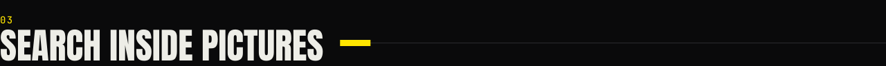

<table>
<tr>
<td width="38%" valign="top">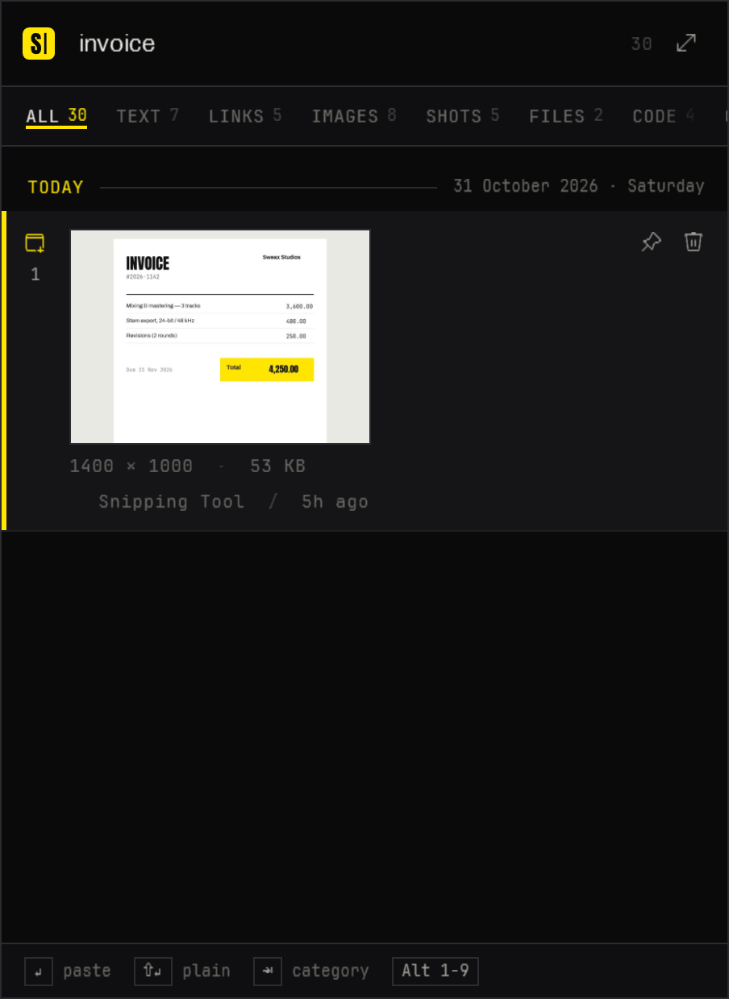</td>
<td valign="top">

Screenshots are read with the OCR engine built into Windows, on your PC, in the background. Type a word that appears *inside* a picture and the picture shows up.

Search covers the text of every clip, the words in every image, the app it came from and the window title. It ignores case and accents and understands Turkish letters — `istanbul` finds `İSTANBUL`, `sef` finds `Şef`. The index is a SQLite FTS5 trigram index, so partial words match too and results appear as you type.

</td>
</tr>
</table>

<br>

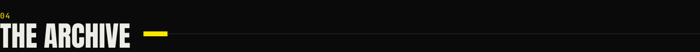

<p align="center">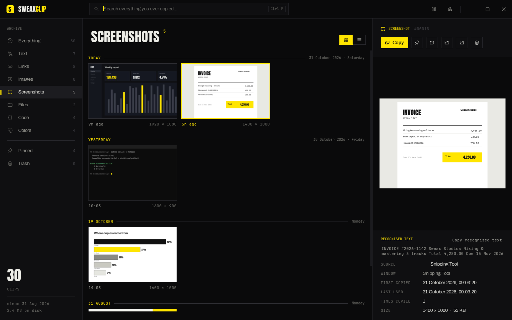</p>

Open the library from the tray (or <kbd>Ctrl</kbd> <kbd>E</kbd> in the panel): every category in a sidebar, images as a contact sheet, and an inspector with the full content, the recognised text, the source app and window, when it was first copied, last used and how many times.

<table>
<tr>
<td width="50%">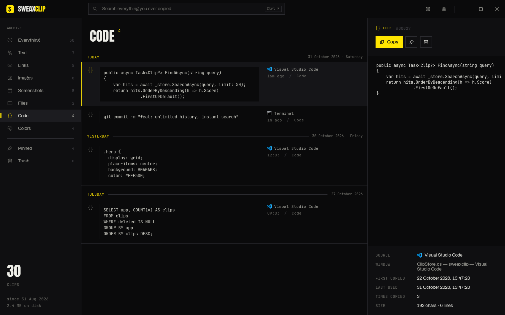</td>
<td width="50%">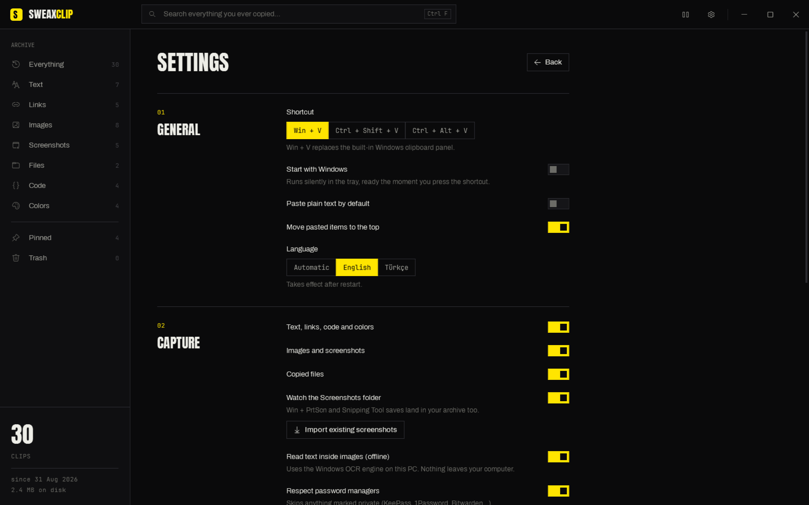</td>
</tr>
</table>

**How it stays for good**

- **No limits.** Nothing is deleted automatically — not after 25 items, not after 30 days, not on restart.
- **One database file** (SQLite, WAL journal, fully synchronous writes) plus image files named by their SHA-256 hash, so the same image is never stored twice.
- **Daily snapshots** of the database: the last 7 days and one per month, kept forever.
- **Export** the whole archive to a single `.zip` from Settings.
- **Portable:** put an empty `sweaxclip-data` folder next to the exe before the first start and the archive lives there instead — on a USB stick, a synced folder, another drive.

| | Windows clipboard history | SweaxClip |
| --- | :---: | :---: |
| Items kept | 25 | Unlimited |
| After a restart | Cleared (except pinned) | Everything stays |
| Images | Up to 4 MB each | Any size, lossless |
| Search | — | Instant, full text |
| Text inside screenshots | — | Offline OCR |
| Categories | — | 8 + Pinned + Trash |
| Screenshots folder | — | Imported and watched |
| Copied files | — | Kept, pasted back as files |
| Backups / export | — | Daily snapshots, `.zip` export |

<br>

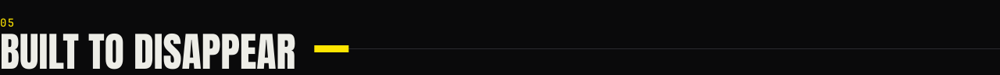

SweaxClip is a native .NET / WPF app — no browser engine inside. Measured on Windows 11 (build 26200) with a 266-item archive:

| | |
| --- | --- |
| Memory while waiting in the tray | **≈ 6 MB** working set |
| CPU while waiting | **0 %** — 16 ms over 15 s, nothing polls |
| Memory with the panel open | ≈ 110 MB, handed back 2 s after it closes |
| Install | one exe, no runtime to install |

- The clipboard is watched with `AddClipboardFormatListener`: Windows wakes SweaxClip when something is copied, otherwise it does not run at all.
- The <kbd>Win</kbd> + <kbd>V</kbd> hook lives on its own thread with its own message loop, so a busy UI can never make Windows drop it; it is re-armed every 10 minutes and after unlocking the PC.
- Hashing, PNG encoding, thumbnails and OCR run on background threads, one item at a time.
- Lists are virtualised and thumbnails decoded at the size they are drawn.

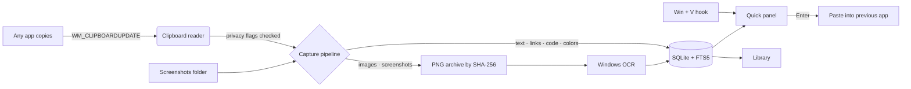

<br>

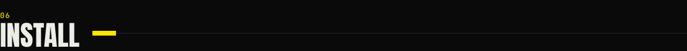

1. Download **[`SweaxClip-win-x64.zip`](https://github.com/Sweax3169/sweaxclip/releases/latest/download/SweaxClip-win-x64.zip)** from [Releases](https://github.com/Sweax3169/sweaxclip/releases/latest) and unzip it.
2. Run `SweaxClip.exe`. It copies itself to `%LOCALAPPDATA%\Programs\SweaxClip`, starts with Windows, adds itself to the Start menu and imports the screenshots you already have.
3. Press <kbd>Win</kbd> + <kbd>V</kbd>.

Already have the [.NET 9 Desktop Runtime](https://dotnet.microsoft.com/download/dotnet/9.0)? [`SweaxClip-lite.exe`](https://github.com/Sweax3169/sweaxclip/releases/latest/download/SweaxClip-lite.exe) is a much smaller download of the same app.

> **"Windows protected your PC"** — the exe is not code-signed yet. Click *More info → Run anyway*. The full source is here, and the release is built by GitHub Actions from this repository.

**Command line**

| | |
| --- | --- |
| `SweaxClip.exe` | Start, or open the library if it is already running |
| `SweaxClip.exe --background` | Start silently in the tray (used at sign-in) |
| `SweaxClip.exe --toggle` | Open / close the quick panel |
| `SweaxClip.exe --quit` | Exit the running instance |

**Build from source** — needs the [.NET 9 SDK](https://dotnet.microsoft.com/download/dotnet/9.0):

```powershell
git clone https://github.com/Sweax3169/sweaxclip
cd sweaxclip
dotnet run --project src/SweaxClip
# single-file release build (what the release workflow runs)
dotnet publish src/SweaxClip -c Release -r win-x64 --self-contained -p:PublishSingleFile=true -p:IncludeNativeLibrariesForSelfExtract=true -p:PublishReadyToRun=true -o publish
```

`SweaxClip.exe --demo` opens the library on a throw-away archive filled with sample data; `--shots <dir>` renders every screenshot in this README.

<br>

## Privacy

Everything stays on your computer. SweaxClip makes no network requests: no account, no telemetry, no cloud. OCR runs on the Windows engine locally.

Copies that apps mark as private are skipped — KeePass, KeePassXC, 1Password, Bitwarden and other password managers set the standard `ExcludeClipboardContentFromMonitorProcessing` / `CanIncludeInClipboardHistory` flags, and SweaxClip honours them. You can also list apps to ignore, or pause capture from the tray.

The archive lives in `%LOCALAPPDATA%\SweaxClip` (`sweaxclip.db`, `blobs\`, `thumbs\`, `backups\`).

## FAQ

<details>
<summary><b>Does it turn off Windows' own clipboard history?</b></summary>
<br>
No setting is changed. SweaxClip takes the <kbd>Win</kbd> + <kbd>V</kbd> key press before Windows sees it. Pick another shortcut in Settings and <kbd>Win</kbd> + <kbd>V</kbd> goes back to Windows.
</details>

<details>
<summary><b>How big does the archive get?</b></summary>
<br>
Text is small — tens of thousands of clips take tens of MB, search index included. Images are what take space; the library sidebar shows the size on disk. Delete what you do not need and empty the trash.
</details>

<details>
<summary><b>How do I move to a new PC?</b></summary>
<br>
Settings → <i>Export everything (.zip)</i>, then unzip it into <code>%LOCALAPPDATA%\SweaxClip</code> on the new PC before starting SweaxClip.
</details>

<details>
<summary><b>Some apps don't receive the paste.</b></summary>
<br>
SweaxClip pastes with <kbd>Ctrl</kbd> + <kbd>V</kbd>. Windows does not let a normal app send keys into apps running as administrator; run SweaxClip as administrator too, or use <kbd>Ctrl</kbd> <kbd>C</kbd> in the panel and paste yourself.
</details>

<details>
<summary><b>How do I uninstall?</b></summary>
<br>
Tray icon → <i>Quit</i>, turn off <i>Start with Windows</i> first if you like, then delete <code>%LOCALAPPDATA%\Programs\SweaxClip</code> (the app) and <code>%LOCALAPPDATA%\SweaxClip</code> (your archive).
</details>

## License

[MIT](LICENSE) © 2026 Sweax Studios. Fonts: Archivo, Anton and JetBrains Mono under the SIL Open Font License — see [THIRD_PARTY_NOTICES.md](THIRD_PARTY_NOTICES.md).

<br>

<p align="center"></p>
