<a href="https://sweax3169.github.io/sweaxclip/">
  <picture>
    <source media="(prefers-color-scheme: dark)" srcset="docs/art/banner-tr-dark.svg">
    
  </picture>
</a>

<p align="center">
  <a href="https://github.com/Sweax3169/sweaxclip/releases/latest/download/SweaxClip-win-x64.zip"><b>Windows için indir</b></a>
  &nbsp;&nbsp;·&nbsp;&nbsp;
  <a href="https://sweax3169.github.io/sweaxclip/">Web sitesi</a>
  &nbsp;&nbsp;·&nbsp;&nbsp;
  <a href="CHANGELOG.md">Yenilikler</a>
  &nbsp;&nbsp;·&nbsp;&nbsp;
  <a href="README.md">English</a>
</p>

<p align="center">
  <a href="https://github.com/Sweax3169/sweaxclip/releases/latest"></a>
  <a href="https://github.com/Sweax3169/sweaxclip/releases"></a>
  <a href="https://github.com/Sweax3169/sweaxclip/actions/workflows/build.yml"></a>
  
  
  <a href="LICENSE"></a>
</p>

<br>

<p align="center">
  <picture>
    <source media="(prefers-color-scheme: dark)" srcset="docs/media/quick-panel-tr-dark.gif">
    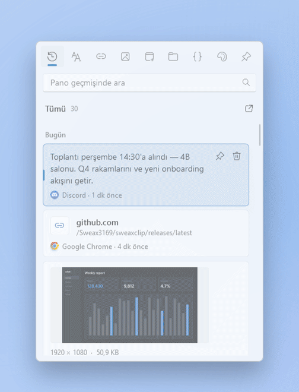
  </picture>
</p>
<p align="center"><sub>Bir metin düzenleyicide <kbd>Win</kbd> + <kbd>V</kbd>. Panel imlecin altında açılır, <kbd>↓</kbd> geçmişte geriye gider, <kbd>Tab</kbd> kategori değiştirir, <kbd>Enter</kbd> bağlantıyı metne yerleştirir.</sub></p>

<br>

## Neden SweaxClip

Windows'un kendi pano geçmişi son 25 öğeyi tutar ve bilgisayar her yeniden başladığında hepsini siler. Geçen hafta kopyaladığın adres, geçen ay aldığın kod parçası, baharda ekran görüntüsünü aldığın fatura — hepsi gider.

SweaxClip kopyaladığın her şeyi — metin, bağlantı, kod, renk, görsel, ekran görüntüsü ve dosya — kendi diskindeki bir arşivde saklar; yeniden başlatmalar, güncellemeler ve yıllar geçse de durur. Aynı kısayolla, aynı yerde açılır ve tepside yaklaşık 10 MB bellekle bekler.

<table>
<tr>
<td width="33%" valign="top">
<picture><source media="(prefers-color-scheme: dark)" srcset="docs/art/feature-where-dark.svg"></picture>
<h3>Yazdığın yerde açılır</h3>
<p>Yazı imlecinin altında — Chrome, Edge, Word, VS Code ve imleç konumunu bildiren her uygulamada — imleç yoksa görev çubuğunun üstünde. Seçtiğin kayıt yazdığın pencereye yapıştırılır.</p>
</td>
<td width="33%" valign="top">
<picture><source media="(prefers-color-scheme: dark)" srcset="docs/art/feature-history-dark.svg"></picture>
<h3>Hiçbir şeyi unutmaz</h3>
<p>Sınır yok, süre dolmaz. Aynı şeyi iki kez kopyalarsan yeni kayıt açılmaz, eskisi en üste çıkar. Sık kullandıklarını sabitle; sildiklerin sen boşaltana kadar Çöp'te bekler.</p>
</td>
<td width="33%" valign="top">
<picture><source media="(prefers-color-scheme: dark)" srcset="docs/art/feature-ocr-dark.svg"></picture>
<h3>Ekran görüntülerini okur</h3>
<p>Görseller Windows'un kendi OCR motoruyla, bilgisayarında okunur. Bir ekran görüntüsünde geçen kelimeyi yaz; o görüntü, kelime işaretlenmiş hâlde gelir.</p>
</td>
</tr>
<tr>
<td width="33%" valign="top">
<picture><source media="(prefers-color-scheme: dark)" srcset="docs/art/feature-kinds-dark.svg"></picture>
<h3>Geldiği an ayrılır</h3>
<p>Metin, bağlantı, görsel, ekran görüntüsü, dosya, kod ve renk; her birinin kendi kategorisi ve kendi rengi var. <kbd>Tab</kbd> klavyeden ayrılmadan aralarında gezdirir.</p>
</td>
<td width="33%" valign="top">
<picture><source media="(prefers-color-scheme: dark)" srcset="docs/art/feature-private-dark.svg"></picture>
<h3>Bilgisayarından çıkmaz</h3>
<p>Hesap yok, telemetri yok, hiçbir ağ isteği yok. Şifre yöneticilerinin gizli işaretlediği kopyalar hiç saklanmaz; kaydı tepsiden duraklatabilirsin.</p>
</td>
<td width="33%" valign="top">
<picture><source media="(prefers-color-scheme: dark)" srcset="docs/art/feature-library-dark.svg"></picture>
<h3>Hepsi için bir kütüphane</h3>
<p>Kopyaladığın her şey, günlere göre dizili. Birini eline al ve tamamını gör: metnin hepsi, görselin tam boyu, nereden geldiği ve kaç kez kullandığın.</p>
</td>
</tr>
</table>

<br>

## Panel

<kbd>Win</kbd> + <kbd>V</kbd>'ye bas. Panel bir zaman çizelgesidir: her kaydın kopyalandığı an soldaki çizgi boyunca akar ve her kayıt kendi içeriğini gösterir — metnin kendisi, bağlantının sitesi, renkleriyle kod, rengin kendisi, görselden bir şerit.

Seçili kayıt açılır. Metin yedi satıra kadar uzar, görsel gerçek bir önizlemeye büyür, kod sekiz satır gösterir, bağlantı tam adresini ve kopyalandığı sayfayı gösterir; hangi uygulamadan kopyalandığını da görürsün. Paneldeki her hareket yaylarla çalışır; oklarla geçmişte gezmek sıçramalar dizisi değil, tek ve kesintisiz bir hareket gibi hissettirir.

<table>
<tr>
<td width="33%"><picture><source media="(prefers-color-scheme: dark)" srcset="docs/shots/tr/panel-images-dark.png">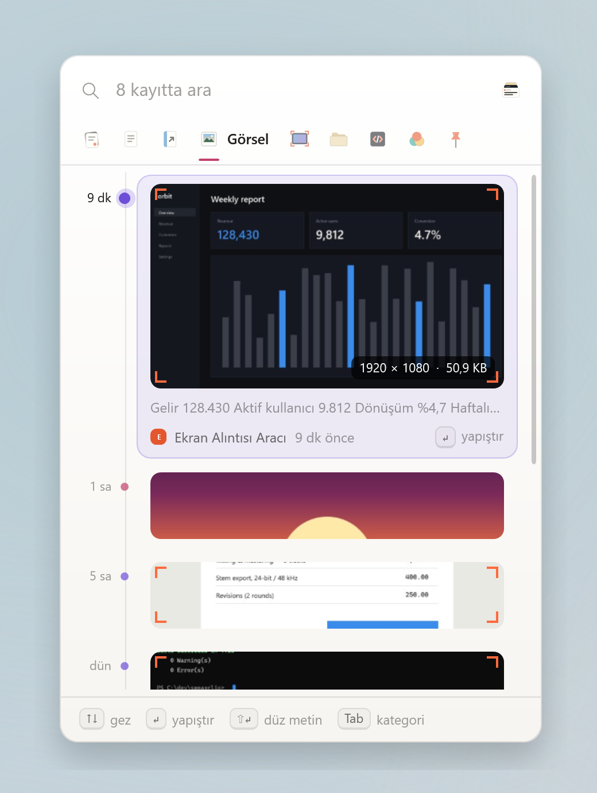</picture></td>
<td width="33%"><picture><source media="(prefers-color-scheme: dark)" srcset="docs/shots/tr/panel-code-dark.png">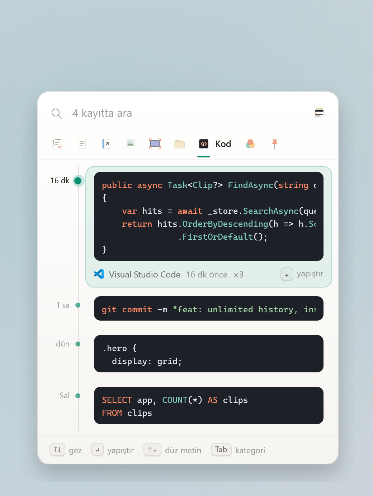</picture></td>
<td width="33%"><picture><source media="(prefers-color-scheme: dark)" srcset="docs/shots/tr/panel-links-dark.png">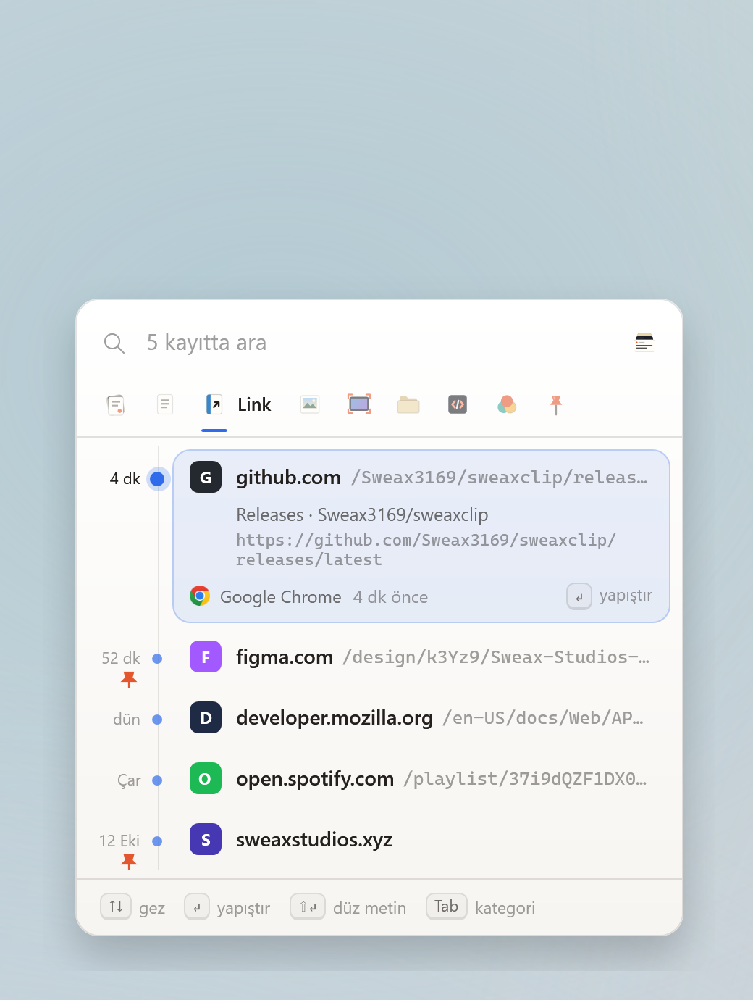</picture></td>
</tr>
<tr>
<td align="center"><sub><b>Görseller.</b> Açık kayıt önizlemeye büyür, okunan yazısıyla birlikte.</sub></td>
<td align="center"><sub><b>Kod.</b> Sözdizimi renkleri, satırlar ve girintiler korunur.</sub></td>
<td align="center"><sub><b>Bağlantılar.</b> Site, yol ve kopyalandığı sayfa.</sub></td>
</tr>
</table>

**Nerede açılır.** Tam Windows'un kendi pano panelini açtığı yerde: yazı imlecinin altında, imleç ekranın dibine yakınsa üstünde; imleç bulunamazsa görev çubuğunun üstünde ortada. Başlat ve Windows Arama her uygulamanın üstündeki bir katmanda çizilir; kısayola bastığında biri açıksa SweaxClip önce onu kapatır, görev çubuğunun üstünde açılır ve seçtiğin kaydı Arama'ya yapıştırır.

**Tuşlar**

| Tuşlar | Panelde |
| --- | --- |
| <kbd>Win</kbd> <kbd>V</kbd> | Aç veya kapat |
| <kbd>↑</kbd> <kbd>↓</kbd> · <kbd>PgUp</kbd> <kbd>PgDn</kbd> · <kbd>Home</kbd> <kbd>End</kbd> | Geçmişte gez |
| <kbd>Enter</kbd> veya tıkla | Yazdığın uygulamaya yapıştır |
| <kbd>Shift</kbd> <kbd>Enter</kbd> | Biçimsiz, düz metin olarak yapıştır |
| <kbd>Alt</kbd>'a basılı tut, <kbd>1</kbd>–<kbd>9</kbd> | En yeni dokuz kayıttan birini yapıştır — <kbd>Alt</kbd> basılıyken numaralar çizgide görünür |
| <kbd>Tab</kbd> · <kbd>Shift</kbd> <kbd>Tab</kbd> · <kbd>←</kbd> <kbd>→</kbd> | Sonraki veya önceki kategori |
| <kbd>Ctrl</kbd> <kbd>1</kbd>–<kbd>9</kbd> | Bir kategoriye atla |
| Yazmaya başla | Her şeyde ara, görsellerin içindeki yazı dahil |
| <kbd>Ctrl</kbd> <kbd>P</kbd> | Sabitle veya kaldır |
| <kbd>Delete</kbd> | Çöp'e taşı |
| <kbd>Ctrl</kbd> <kbd>C</kbd> | Yapıştırmadan kopyala |
| <kbd>Ctrl</kbd> <kbd>O</kbd> | Bağlantıyı, dosyayı veya görseli aç |
| <kbd>Ctrl</kbd> <kbd>E</kbd> | Kaydı kütüphanede göster |
| <kbd>Esc</kbd> | Aramayı temizle, sonra kapat |

Kısayol <kbd>Ctrl</kbd> <kbd>Shift</kbd> <kbd>V</kbd> veya <kbd>Ctrl</kbd> <kbd>Alt</kbd> <kbd>V</kbd> da olabilir (Ayarlar → Genel). Bir kaydın üstüne gelince sabitle ve sil düğmeleri çıkar; sağ tıkta bütün işlemler var.

<br>

## Ekran görüntülerinin içinde arama

<table>
<tr>
<td width="46%" valign="top">
<picture>
  <source media="(prefers-color-scheme: dark)" srcset="docs/media/search-tr-dark.gif">
  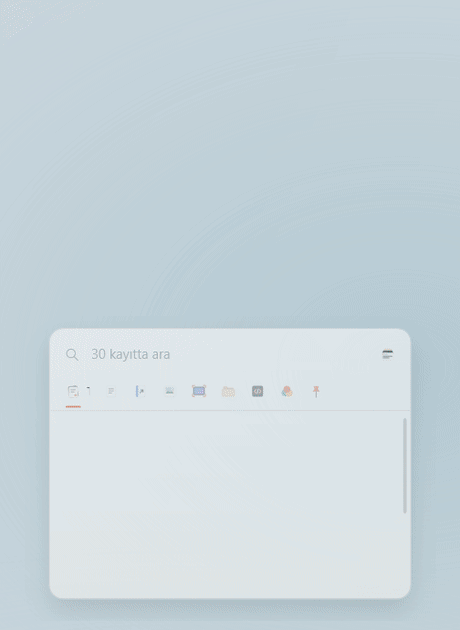
</picture>
</td>
<td valign="top">

Her görsel ve ekran görüntüsü arka planda, Windows'la gelen OCR motoruyla (`Windows.Media.Ocr`) bir kez okunur. Bulunan yazı görselle birlikte saklanır ve diğer metinler gibi aranır.

- Bir kelimenin birkaç harfini yaz. Panel sen yazdıkça daralır ve kalanların boyuna süzülür.
- Eşleşmeler kaydın içinde işaretlenir — metinde, bağlantının adresinde, dosya adında ya da görselden okunan yazıda.
- Büyük/küçük harf, aksan ve Türkçe karakter fark etmez: `fatura`, `FATURA` ve `faturá` aynı kayıtları bulur, `isik` yazınca `ışık` çıkar.
- Dizin üç harflik parçalardan kurulur (FTS5 trigram), kelimenin bir parçası yeter.
- OCR bilgisayarında, Windows'ta yüklü dillerle çalışır. Hiçbir şey yüklenmez.

</td>
</tr>
</table>

<br>

## Kütüphane

Kopyaladığın her şey tek bir masada. Tepsi simgesinden, panelde <kbd>Ctrl</kbd> <kbd>E</kbd> ile ya da `SweaxClip.exe`'yi yeniden çalıştırarak açılır.

<picture>
  <source media="(prefers-color-scheme: dark)" srcset="docs/shots/tr/hero-dark.png">
  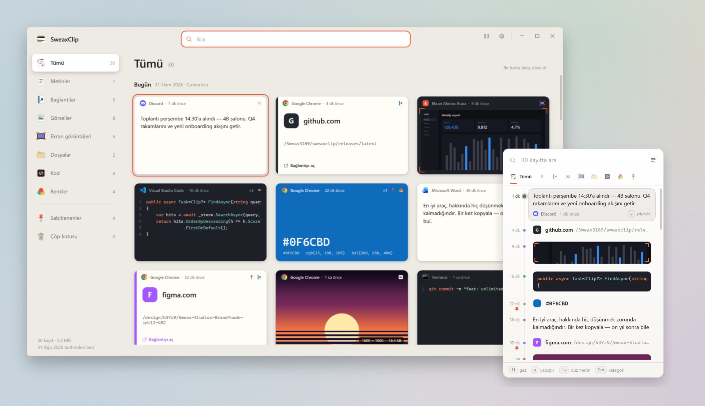
</picture>

Her kayıt kendi nesnesi olarak çizilir: metin bir kâğıt yaprağında, bağlantı sitesinin renginde, kod arduvaz üstünde, renk rengin kendisi olarak, görsel bir baskı olarak, ekran görüntüsü kırpma işaretli bir çerçevede, kopyalanan dosyalar bir klasörde. Herhangi birine tıklayıp eline al.

<table>
<tr>
<td width="50%">
<picture><source media="(prefers-color-scheme: dark)" srcset="docs/shots/tr/library-lightbox-dark.png">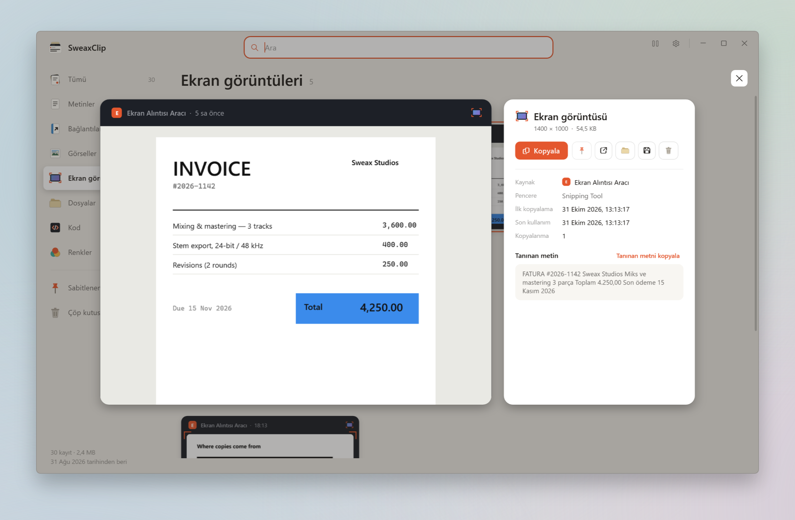</picture>
<p align="center"><sub>Eline alınmış bir ekran görüntüsü: tam boy, nereden geldiği, içinden okunan yazı</sub></p>
</td>
<td width="50%">
<picture><source media="(prefers-color-scheme: dark)" srcset="docs/shots/tr/library-code-dark.png">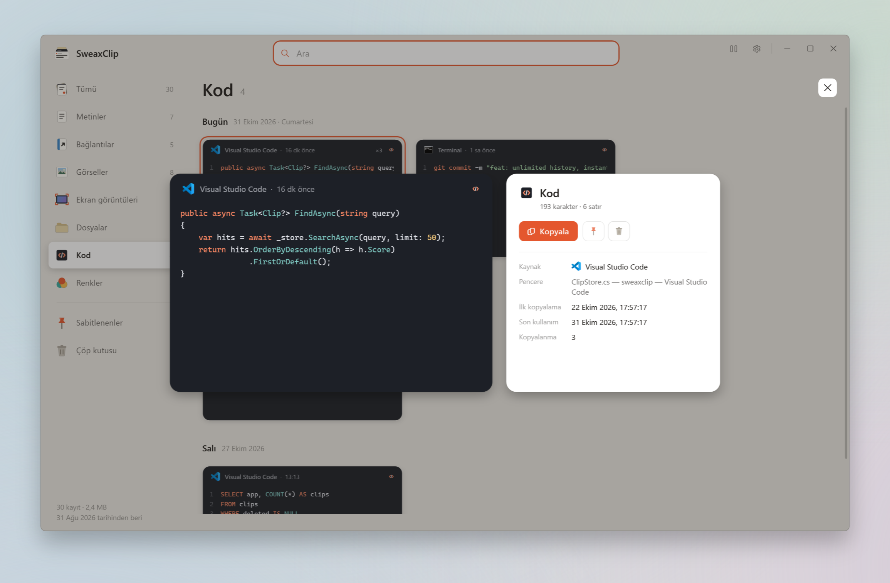</picture>
<p align="center"><sub>Kod biçimini ve renklerini korur</sub></p>
</td>
</tr>
<tr>
<td width="50%">
<picture><source media="(prefers-color-scheme: dark)" srcset="docs/shots/tr/library-screenshots-dark.png">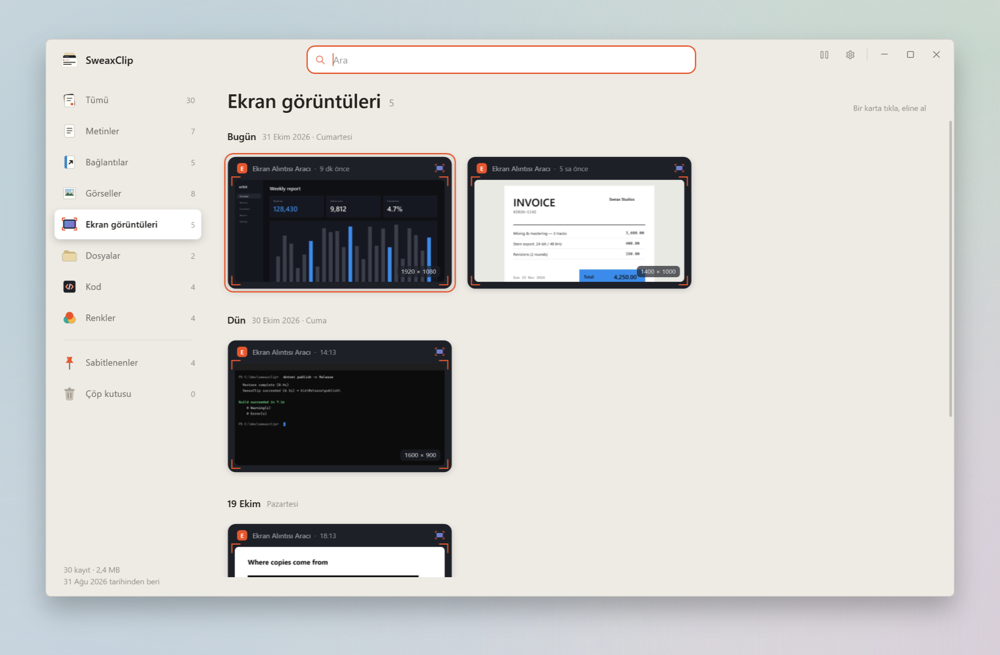</picture>
<p align="center"><sub>Aldığın her ekran görüntüsü, günlere göre</sub></p>
</td>
<td width="50%">
<picture><source media="(prefers-color-scheme: dark)" srcset="docs/shots/tr/library-settings-dark.png">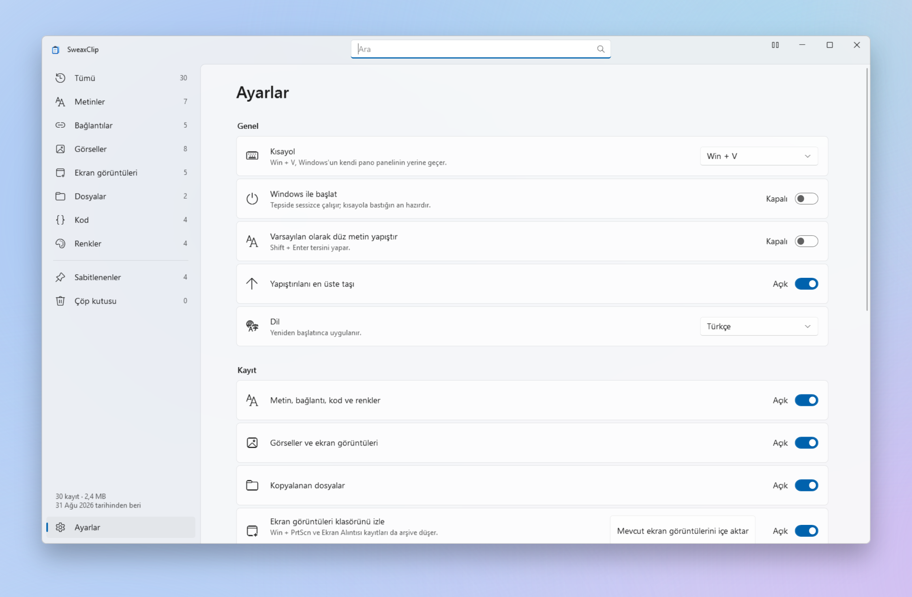</picture>
<p align="center"><sub>Ayarlar</sub></p>
</td>
</tr>
</table>

<details>
<summary><b>Kütüphane tuşları</b></summary>
<br>

| Tuşlar | Kütüphanede |
| --- | --- |
| Tıkla · <kbd>Space</kbd> | Seçili kaydı eline al ya da geri koy |
| Ok tuşları · <kbd>PgUp</kbd> <kbd>PgDn</kbd> | Kayıtlar arasında gez |
| <kbd>Enter</kbd> · <kbd>Shift</kbd> <kbd>Enter</kbd> | Kopyala · düz metin olarak kopyala |
| <kbd>Ctrl</kbd> <kbd>Tab</kbd> · <kbd>Ctrl</kbd> <kbd>1</kbd>–<kbd>9</kbd> · <kbd>Ctrl</kbd> <kbd>0</kbd> | Sonraki kategori · kategoriye atla · Çöp |
| <kbd>Ctrl</kbd> <kbd>F</kbd> | Ara |
| <kbd>Ctrl</kbd> <kbd>P</kbd> · <kbd>Delete</kbd> | Sabitle · Çöp'e taşı (Çöp'teyken: kalıcı sil) |
| <kbd>Ctrl</kbd> <kbd>O</kbd> | Bağlantıyı, dosyayı veya görseli aç |
| <kbd>Ctrl</kbd> <kbd>,</kbd> | Ayarlar |
| <kbd>Esc</kbd> | Kaydı geri koy, aramayı temizle, kapat |

</details>

<br>

## Windows ile karşılaştırma

| | Windows pano geçmişi | SweaxClip |
| --- | :---: | :---: |
| Tutulan öğe | 25 | Sınırsız |
| Yeniden başlatınca | Silinir (sabitlenenler hariç) | Kalır |
| Görseller | En fazla 4 MB | Her boyutta, kayıpsız |
| Arama | — | Tam metin, görsellerin içindeki yazı dahil |
| Kategoriler | — | 7, artı Sabitlenenler ve Çöp |
| Kopyalanan dosyalar | — | Saklanır, dosya olarak geri yapıştırılır |
| Her kaydın kaynağı | — | Uygulama, pencere başlığı, zaman, kullanım sayısı |
| Ekran görüntüleri klasörü | — | İzlenir; mevcut görüntüler eklenir |
| Yedek | — | Günlük kopya, `.zip` dışa aktarma |

<br>

## Nasıl çalışır

<picture>
  <source media="(prefers-color-scheme: dark)" srcset="docs/art/architecture-dark.svg">
  
</picture>

- **Yakalama.** SweaxClip `AddClipboardFormatListener` ile kaydolur; bir şey kopyalandığında Windows haber verir, sürekli yoklama yoktur. Pano biçimlerini kendisi okur: Unicode metin, HTML ve RTF, PNG ve bitmap verisi, dosya listeleri. `ExcludeClipboardContentFromMonitorProcessing` taşıyan ya da `CanIncludeInClipboardHistory` değeri 0 olan kopyalar — şifre yöneticilerinin kullandığı işaretler — atlanır.
- **Saklama.** WAL modunda, `synchronous=FULL` ayarlı tek bir SQLite veritabanı; yazılmış bir kayıt elektrik kesintisinde bile kaybolmaz. Görseller kayıpsız olarak bir kez, SHA-256 özetleriyle adlandırılmış dosyalarda saklanır; aynı görseli iki kez kopyalamak tek kopya tutar.
- **Arama.** Trigram ayrıştırıcılı bir FTS5 dizini kayıt metnini, görsellerden okunan yazıyı ve kopyalanan dosyaların adlarını kapsar. Metin dizine girmeden önce küçük harfe çevrilir, aksanları kaldırılır, Türkçe harfler sadeleştirilir.
- **OCR.** Arka plandaki bir kuyruk yeni görselleri `Windows.Media.Ocr` ile okur ve yazıyı kaydın yanına koyar.
- **Kısayol.** Kendi iş parçacığında çalışan düşük seviyeli bir klavye kancası <kbd>Win</kbd> + <kbd>V</kbd>'yi Windows'tan önce alır; hiçbir Windows ayarı değişmez. Yazı imleci önce `GetGUIThreadInfo` ile, kendi imlecini çizen tarayıcı ve düzenleyicilerde ise erişilebilirlik imleciyle (`OBJID_CARET`) bulunur.
- **Yapıştırma.** Kayıt tüm biçimleriyle panoya geri konur, odak yazdığın pencereye döner ve SweaxClip <kbd>Ctrl</kbd> + <kbd>V</kbd> gönderir.
- **Kaynak kullanımı.** Tepside yaklaşık 8–12 MB bellek, sıfır işlemci. Panel kapanınca kullandığı bellek Windows'a geri verilir.
- **Yedek.** Veritabanı her gün `VACUUM INTO` ile kopyalanır; son yedi gün ve her aydan bir kopya tutulur.

<details>
<summary><b>Veri klasöründe neler var</b></summary>
<br>

```
%LOCALAPPDATA%\SweaxClip\
├── sweaxclip.db     kayıtlar ve arama dizini (SQLite, WAL)
├── blobs\           görseller, her biri bir kez, SHA-256 adıyla
├── thumbs\          panel ve kütüphane için küçük önizlemeler
├── backups\         günlük veritabanı kopyaları
├── logs\            sorun gidermek için kısa bir günlük
└── settings.json
```

Arşivi başka bir yerde tutmak için — başka bir disk, eşitlenen bir klasör, bir USB bellek — ilk açılıştan önce `SweaxClip.exe`'nin yanına `sweaxclip-data` adında boş bir klasör oluştur. SweaxClip taşınabilir modda çalışır ve her şeyi orada tutar.

</details>

<br>

## Gizlilik

SweaxClip hiçbir ağ isteği yapmaz. Hesap, analiz, güncelleme kontrolü ve bulut eşitleme yoktur; sakladığı her şey yukarıdaki veri klasöründe kalır.

- KeePass, KeePassXC, 1Password ve Bitwarden gibi şifre yöneticileri kopyalarını gizli olarak işaretler. SweaxClip bunları atlar.
- **Ayarlar → Kayıt** bölümünde uygulamaları adıyla yok sayabilirsin; onlarda kopyalanan hiçbir şey saklanmaz.
- Kayıt tepsi simgesinden ya da kütüphanenin başlık çubuğundan duraklatılabilir; duraklatıldığında panel bunu gösterir.
- Silinen kayıtlar Çöp'e gider. Çöp'ü boşaltmak kayıtları ve görsel dosyalarını diskten siler.

<br>

## Kurulum

1. [`SweaxClip-win-x64.zip`](https://github.com/Sweax3169/sweaxclip/releases/latest/download/SweaxClip-win-x64.zip) dosyasını indir ve istediğin yere aç.
2. `SweaxClip.exe`'yi çalıştır. Kendini `%LOCALAPPDATA%\Programs\SweaxClip` klasörüne kopyalar, Windows ile başlar ve Başlat menüsüne eklenir.
3. <kbd>Win</kbd> + <kbd>V</kbd>'ye bas.

İlk açılışta *Resimler\Ekran görüntüleri* klasöründe zaten olan görüntüler arşive eklenir.

Bilgisayarında [.NET 9 Desktop Runtime](https://dotnet.microsoft.com/download/dotnet/9.0) zaten kuruluysa [`SweaxClip-lite.exe`](https://github.com/Sweax3169/sweaxclip/releases/latest/download/SweaxClip-lite.exe) aynı uygulamanın çok daha küçük bir indirmesidir.

> [!NOTE]
> Uygulama henüz kod imzalı değil, bu yüzden Windows SmartScreen uyarı gösterebilir. **Ek bilgi → Yine de çalıştır**'ı seç. Her sürüm bu depodan [GitHub Actions](.github/workflows/build.yml) ile derlenir ve `SHA256SUMS.txt` içinde SHA-256 özetleri listelenir.

**Gereksinimler:** Windows 10 (2004 sürümü) veya Windows 11, 64 bit.

**Güncelleme:** tepsi simgesinden SweaxClip'ten çık, sonra yeni `SweaxClip.exe`'yi çalıştır. Geçmişin korunur.

<br>

## Komut satırı

| Komut | Etkisi |
| --- | --- |
| `SweaxClip.exe` | Başlat; zaten çalışıyorsa kütüphaneyi aç |
| `SweaxClip.exe --background` | Pencere açmadan tepside başlat |
| `SweaxClip.exe --toggle` | Paneli aç veya kapat — fare tuşları, makro tuşları ve Stream Deck için |
| `SweaxClip.exe --quit` | Çalışan örneği kapat |

<br>

## Kaynak koddan derleme

Windows'ta [.NET 9 SDK](https://dotnet.microsoft.com/download/dotnet/9.0) gerekir.

```powershell
git clone https://github.com/Sweax3169/sweaxclip
cd sweaxclip
dotnet run --project src/SweaxClip -- --demo
```

`--demo` kütüphaneyi örnek verilerle dolu geçici bir arşivle açar; kendi geçmişine dokunmadan her şeyi deneyebilirsin. Bu sayfadaki her ekran görüntüsü ve animasyon aynı örnek veriden [`tools/render-media.ps1`](tools/render-media.ps1) ile üretilir: uygulama kendini her karede bir yay adımı ilerleterek çeker, yani burada gördüğün tam olarak uygulamanın yaptığıdır.

Yayın sürümünü derlemek için:

```powershell
dotnet publish src/SweaxClip -c Release -r win-x64 --self-contained -p:PublishSingleFile=true -p:IncludeNativeLibrariesForSelfExtract=true -p:PublishReadyToRun=true -o publish
```

<details>
<summary><b>Proje yapısı</b></summary>
<br>

```
src/SweaxClip/
├── App.xaml.cs          açılış, tek örnek, tepsi, kısayol, kurulum
├── Core/
│   ├── ClipboardReader  pano biçimleri, gizlilik işaretleri
│   ├── CapturePipeline  her kopyayı ayırır (metin, bağlantı, kod, renk, görsel, dosya), tekrarları birleştirir
│   ├── ClipStore        SQLite arşivi, FTS5 arama, Çöp, yedekler
│   ├── OcrService       Windows OCR kuyruğu
│   ├── KeyboardHook     kendi iş parçacığında Win + V
│   └── Paster           kaydı panoya geri koyar ve yapıştırır
├── UI/
│   ├── QuickPanel       Win + V zaman çizelgesi
│   ├── PanelRows.xaml   her kayıt türünün paneldeki görünüşü
│   ├── Motion           yaylar, açılma ve büyüme
│   ├── LibraryWindow    masa ve ışık kutusu
│   ├── Cards.xaml       her kayıt türü kendi kartı olarak
│   └── CaretLocator     yazı imlecinin yeri
└── Dev/                 örnek arşiv ve README görsellerini üreten kod
```

</details>

<br>

## Sık sorulanlar

<details>
<summary><b>SweaxClip Windows pano geçmişini kapatıyor mu?</b></summary>
<br>
Hiçbir Windows ayarı değişmez. SweaxClip <kbd>Win</kbd> + <kbd>V</kbd> tuşunu Windows'tan önce alır. Ayarlar'dan başka bir kısayol seçersen <kbd>Win</kbd> + <kbd>V</kbd> yine Windows panelini açar.
</details>

<details>
<summary><b>Ne kadar disk alanı kullanır?</b></summary>
<br>
Metin çok az yer tutar — on binlerce kayıt, arama dizini dahil onlarca megabayta sığar. Yerin çoğunu görseller kaplar; kütüphane toplamı sol alt köşede gösterir. Sildiğin kayıtlar Çöp'e gider ve sen boşaltana kadar diskten silinmez.
</details>

<details>
<summary><b>Panel imlecimin altında değil, görev çubuğunun üstünde açıldı.</b></summary>
<br>
Bazı uygulamalar yazı imlecini kendileri çizer ve yerini Windows'a bildirmez. SweaxClip imleci bulamazsa Windows panelinin yaptığı gibi görev çubuğunun üstünde açılır; yapıştırma yine yazdığın uygulamaya gider.
</details>

<details>
<summary><b>Bazı uygulamalarda yapıştırma çalışmıyor.</b></summary>
<br>
SweaxClip <kbd>Ctrl</kbd> + <kbd>V</kbd> göndererek yapıştırır; Windows, uygulamaların yönetici olarak çalışan programlara tuş göndermesine izin vermez. SweaxClip'i de yönetici olarak çalıştır ya da panelde <kbd>Ctrl</kbd> + <kbd>C</kbd>'ye basıp kendin yapıştır.
</details>

<details>
<summary><b>Ekran görüntülerinde hangi dilleri okuyabilir?</b></summary>
<br>
OCR bileşeni Windows'ta yüklü olan dilleri — genelde Windows'a eklediğin dilleri. Daha fazlası Ayarlar → Saat ve dil → Dil ve bölge'den eklenebilir.
</details>

<details>
<summary><b>Geçmişimi başka bir bilgisayara nasıl taşırım?</b></summary>
<br>
<b>Ayarlar → Depolama → Arşivi dışa aktar</b>'ı kullan, ardından yeni bilgisayarda SweaxClip'i başlatmadan önce <code>.zip</code>'i <code>%LOCALAPPDATA%\SweaxClip</code> klasörüne aç.
</details>

<details>
<summary><b>Nasıl kaldırırım?</b></summary>
<br>
Ayarlar'dan <b>Windows ile başlat</b>'ı kapat, sonra tepsi simgesine sağ tıklayıp <b>Çık</b>'ı seç. <code>%LOCALAPPDATA%\Programs\SweaxClip</code> klasörünü (uygulama) ve geçmişini artık istemiyorsan <code>%LOCALAPPDATA%\SweaxClip</code> klasörünü sil.
</details>

<br>

## Lisans

[MIT](LICENSE) © 2026 Sweax Studios. Üçüncü taraf bileşenler [THIRD_PARTY_NOTICES.md](THIRD_PARTY_NOTICES.md) dosyasında listelenir.

<br>

<p align="center">
  
  <br>
  <sub><a href="https://github.com/Sweax3169">Sweax</a> · <a href="https://sweaxstudios.xyz">Sweax Studios</a> tarafından, Türkiye'de yapıldı</sub>
</p>
