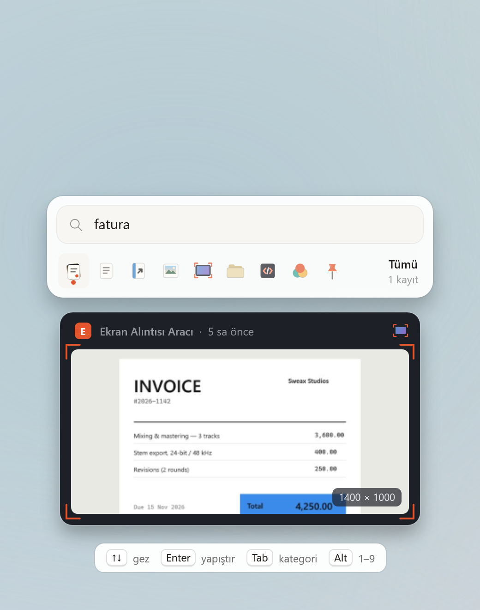

<p align="center">
  
</p>

<h1 align="center">SweaxClip</h1>

<p align="center">
  Windows için kalıcı ve aranabilir pano geçmişi.<br>
  <kbd>Win</kbd> + <kbd>V</kbd>'ye bas; bugüne kadar kopyaladığın her şey orada.
</p>

<p align="center">
  <a href="https://github.com/Sweax3169/sweaxclip/releases/latest/download/SweaxClip-win-x64.zip"><b>Windows için indir</b></a>
  &nbsp;·&nbsp;
  <a href="https://sweax3169.github.io/sweaxclip/">Web sitesi</a>
  &nbsp;·&nbsp;
  <a href="README.md">English</a>
</p>

<p align="center">
  <a href="https://github.com/Sweax3169/sweaxclip/releases/latest"></a>
  <a href="https://github.com/Sweax3169/sweaxclip/releases"></a>
  <a href="https://github.com/Sweax3169/sweaxclip/actions/workflows/build.yml"></a>
  
  <a href="LICENSE"></a>
</p>

<br>

<picture>
  <source media="(prefers-color-scheme: dark)" srcset="docs/shots/tr/hero-dark.png">
  
</picture>

## Neden SweaxClip

Windows'un kendi pano geçmişi son 25 öğeyi tutar ve bilgisayar her yeniden başladığında hepsini siler. SweaxClip kopyaladığın her şeyi — metin, bağlantı, kod, renk, görsel, ekran görüntüsü ve dosya — yeniden başlatmalarda silinmeyen yerel bir arşivde saklar ve aynı kısayolla açılır.

- **<kbd>Win</kbd> + <kbd>V</kbd>'nin yerine geçer.** Geçmişin, Windows'un kendi panelini açtığı yerde bir kart destesi olarak dağıtılır — yazı imlecinin altında (Chrome, Edge ve imleç konumunu erişilebilirlik araçlarına bildiren diğer uygulamalarda da) ya da görev çubuğunun üstünde — ve seçtiğin kart yazdığın uygulamaya fırlatılır.
- **Sınırsız geçmiş.** Hiçbir şey kendiliğinden silinmez. Aynı şeyi iki kez kopyalarsan yeni kayıt açılmaz; mevcut kayıt en üste çıkar.
- **Kendiliğinden ayrılır.** Metin, bağlantı, görsel, ekran görüntüsü, dosya, kod ve renk ayrı kategorilerde durur.
- **Ekran görüntülerinin içinde arama.** Görseller Windows'un kendi OCR motoruyla okunur; ekran görüntüsünde geçen bir kelimeyi yazınca o görüntü bulunur.
- **Kalan her şey için kütüphane.** Kategorilere göre gez, görselleri galeri olarak gör, her öğenin nereden geldiğini ve kaç kez kullandığını izle.
- **Her kayıt neyse öyle görünür.** Metin bir kâğıt yaprağı, bağlantı sitesinin rengini taşır, kod arduvaz üstünde renklendirilmiş durur, renk rengin kendisidir, ekran görüntüsü kırpma işaretli bir çerçevede, dosyalar manila bir klasörde gelir. Açık/koyu temanı izler.
- **Kaynak yemez.** Tepside beklerken yaklaşık 10–12 MB bellek kullanır; bir şey kopyalayana kadar işlemciye dokunmaz.
- **Gizli.** Her şey bilgisayarında kalır. Şifre yöneticilerinin gizli işaretlediği kopyalar atlanır.

## Deste

En yeni kayıt öndeki karttır; eskiler arkasında, tanınacak kadar görünerek dizilir. Her kart yaylarla hareket eder — geçmişte gezinmek, bir kategoriyi dağıtmak, kartı imlece fırlatmak ya da çöpe atmak aynı fiziksel hissi paylaşır.

<table>
<tr>
<td width="44%" valign="top">
<picture>
  <source media="(prefers-color-scheme: dark)" srcset="docs/media/quick-panel-tr-dark.gif">
  
</picture>
</td>
<td valign="top">

| Kısayol | İşlem |
| --- | --- |
| <kbd>Win</kbd> <kbd>V</kbd> | Paneli aç veya kapat |
| <kbd>↑</kbd> <kbd>↓</kbd> | Öğe seç |
| <kbd>Enter</kbd> | Yapıştır |
| <kbd>Shift</kbd> <kbd>Enter</kbd> | Düz metin olarak yapıştır |
| <kbd>Alt</kbd>'a basılı tut, <kbd>1</kbd>–<kbd>9</kbd> | Numaralı öğeyi yapıştır |
| <kbd>Tab</kbd> veya <kbd>←</kbd> <kbd>→</kbd> | Kategori değiştir |
| <kbd>Ctrl</kbd> <kbd>P</kbd> | Sabitle veya kaldır |
| <kbd>Delete</kbd> | Çöp kutusuna taşı |
| <kbd>Ctrl</kbd> <kbd>C</kbd> | Yapıştırmadan kopyala |
| <kbd>Ctrl</kbd> <kbd>O</kbd> | Bağlantıyı, dosyayı veya görseli aç |
| <kbd>Ctrl</kbd> <kbd>E</kbd> | Kütüphanede göster |
| Yazmaya başla | Ara |

Kısayolu Ayarlar'dan <kbd>Ctrl</kbd> <kbd>Shift</kbd> <kbd>V</kbd> veya <kbd>Ctrl</kbd> <kbd>Alt</kbd> <kbd>V</kbd> yapabilirsin.

</td>
</tr>
</table>

<table>
<tr>
<td width="33%">
<picture>
  <source media="(prefers-color-scheme: dark)" srcset="docs/shots/tr/panel-images-dark.png">
  
</picture>
</td>
<td width="33%">
<picture>
  <source media="(prefers-color-scheme: dark)" srcset="docs/shots/tr/panel-code-dark.png">
  
</picture>
</td>
<td width="33%">
<picture>
  <source media="(prefers-color-scheme: dark)" srcset="docs/shots/tr/panel-search-dark.png">
  
</picture>
</td>
</tr>
<tr>
<td align="center"><sub>Görseller</sub></td>
<td align="center"><sub>Kod</sub></td>
<td align="center"><sub>Ekran görüntüsünün içinde bulunan kelime</sub></td>
</tr>
</table>

## Kütüphane

Kopyaladığın her şey günlere göre bir masada durur. Bir karta tıkla, eline al: tam boyutta açılır; nereden geldiği, kaç kez kullandığın ve içinde bulunan yazı yanında.

<table>
<tr>
<td width="50%">
<picture>
  <source media="(prefers-color-scheme: dark)" srcset="docs/shots/tr/library-lightbox-dark.png">
  
</picture>
<p align="center"><sub>Eline alınmış bir ekran görüntüsü, içindeki yazıyla</sub></p>
</td>
<td width="50%">
<picture>
  <source media="(prefers-color-scheme: dark)" srcset="docs/shots/tr/library-code-dark.png">
  
</picture>
<p align="center"><sub>Kod biçimini ve renklerini korur</sub></p>
</td>
</tr>
<tr>
<td width="50%">
<picture>
  <source media="(prefers-color-scheme: dark)" srcset="docs/shots/tr/library-screenshots-dark.png">
  
</picture>
<p align="center"><sub>Aldığın her ekran görüntüsü, günlere göre</sub></p>
</td>
<td width="50%">
<picture>
  <source media="(prefers-color-scheme: dark)" srcset="docs/shots/tr/library-settings-dark.png">
  
</picture>
<p align="center"><sub>Ayarlar</sub></p>
</td>
</tr>
</table>

## Kurulum

1. [`SweaxClip-win-x64.zip`](https://github.com/Sweax3169/sweaxclip/releases/latest/download/SweaxClip-win-x64.zip) dosyasını indir ve aç.
2. `SweaxClip.exe`'yi çalıştır. Kendini `%LOCALAPPDATA%\Programs\SweaxClip` klasörüne kurar, Windows ile başlar ve Başlat menüsüne eklenir.
3. <kbd>Win</kbd> + <kbd>V</kbd>'ye bas.

İlk açılışta *Resimler\Ekran görüntüleri* klasöründeki mevcut görüntüler arşive eklenir.

Bilgisayarında [.NET 9 Desktop Runtime](https://dotnet.microsoft.com/download/dotnet/9.0) zaten kuruluysa [`SweaxClip-lite.exe`](https://github.com/Sweax3169/sweaxclip/releases/latest/download/SweaxClip-lite.exe) aynı uygulamanın daha küçük bir indirmesidir.

> [!NOTE]
> Uygulama henüz kod imzalı değil, bu yüzden Windows SmartScreen uyarı gösterebilir. **Ek bilgi → Yine de çalıştır**'ı seç. Sürümler bu depodan [GitHub Actions](.github/workflows/build.yml) ile derlenir ve her sürümde SHA-256 özetleri bulunur.

**Gereksinimler:** Windows 10 (2004 sürümü) veya Windows 11, 64 bit.

## Geçmişin nasıl saklanır

| | Windows pano geçmişi | SweaxClip |
| --- | :---: | :---: |
| Tutulan öğe | 25 | Sınırsız |
| Yeniden başlatınca | Silinir (sabitlenenler hariç) | Kalır |
| Görseller | En fazla 4 MB | Her boyutta, kayıpsız |
| Arama | — | Tam metin, görsellerdeki yazı dahil |
| Kategoriler | — | 7, ayrıca Sabitlenenler ve Çöp kutusu |
| Kopyalanan dosyalar | — | Saklanır, dosya olarak yapıştırılır |
| Yedek | — | Günlük, ayrıca `.zip` dışa aktarma |

Arşiv tek bir SQLite veritabanı (WAL günlüğü, senkron yazma) ve SHA-256 özetiyle adlandırılan görsel dosyalarından oluşur; `%LOCALAPPDATA%\SweaxClip` klasöründe durur. Veritabanının her gün bir kopyası alınır; son yedi gün ve her aydan bir kopya saklanır. **Ayarlar → Depolama** bölümünden her şeyi tek bir `.zip` dosyasına aktarabilirsin.

Arşivi başka bir yerde tutmak için — başka bir disk, eşitlenen bir klasör, USB bellek — ilk açılıştan önce `SweaxClip.exe`'nin yanına `sweaxclip-data` adında boş bir klasör oluştur.

## Gizlilik

SweaxClip hiçbir ağ isteği yapmaz: hesap, telemetri ya da bulut eşitleme yoktur. Metin tanıma bilgisayarındaki Windows OCR motoruyla yapılır.

KeePass, KeePassXC, 1Password ve Bitwarden gibi şifre yöneticileri kopyalarını standart `ExcludeClipboardContentFromMonitorProcessing` ve `CanIncludeInClipboardHistory` bayraklarıyla işaretler; SweaxClip bu kopyaları atlar. Ayrıca yok sayılacak uygulamaları listeleyebilir ya da kaydı tepsi simgesinden duraklatabilirsin.

## Komut satırı

| Komut | Etkisi |
| --- | --- |
| `SweaxClip.exe` | Başlatır; zaten çalışıyorsa kütüphaneyi açar |
| `SweaxClip.exe --background` | Pencere açmadan tepside başlatır |
| `SweaxClip.exe --toggle` | Hızlı paneli açar veya kapatır — fare tuşu ve makro tuşları için kullanışlı |
| `SweaxClip.exe --quit` | Çalışan uygulamayı kapatır |

## Kaynaktan derleme

Windows'ta [.NET 9 SDK](https://dotnet.microsoft.com/download/dotnet/9.0) gerekir.

```powershell
git clone https://github.com/Sweax3169/sweaxclip
cd sweaxclip
dotnet run --project src/SweaxClip -- --demo --lang tr
```

`--demo`, kütüphaneyi örnek verilerle dolu geçici bir arşivde açar; kendi geçmişine dokunmadan uygulamayı deneyebilirsin. `tools/render-media.ps1` bu sayfadaki tüm görselleri aynı örnek veriden yeniden üretir.

Sürüm dosyasını derlemek için:

```powershell
dotnet publish src/SweaxClip -c Release -r win-x64 --self-contained -p:PublishSingleFile=true -p:IncludeNativeLibrariesForSelfExtract=true -p:PublishReadyToRun=true -o publish
```

## Sık sorulanlar

<details>
<summary>SweaxClip Windows'un pano geçmişini kapatıyor mu?</summary>
<br>
Hiçbir Windows ayarı değişmez. SweaxClip, <kbd>Win</kbd> + <kbd>V</kbd> tuşunu Windows'tan önce alır. Ayarlar'dan başka bir kısayol seçersen <kbd>Win</kbd> + <kbd>V</kbd> yine Windows'un panelini açar.
</details>

<details>
<summary>Ne kadar disk alanı kullanır?</summary>
<br>
Metin çok az yer kaplar — on binlerce öğe, arama dizini dahil onlarca megabayta sığar. Yerin çoğunu görseller kaplar; kütüphane toplamı sol alt köşede gösterir. Sildiğin öğeler Çöp kutusuna gider ve çöp yalnızca sen istediğinde boşalır.
</details>

<details>
<summary>Geçmişimi başka bir bilgisayara nasıl taşırım?</summary>
<br>
<b>Ayarlar → Depolama → Arşivi dışa aktar</b>'ı kullan, sonra yeni bilgisayarda SweaxClip'i başlatmadan önce <code>.zip</code> dosyasını <code>%LOCALAPPDATA%\SweaxClip</code> klasörüne aç.
</details>

<details>
<summary>Bazı uygulamalarda yapıştırma çalışmıyor.</summary>
<br>
SweaxClip, <kbd>Ctrl</kbd> + <kbd>V</kbd> göndererek yapıştırır. Windows, yönetici olarak çalışan programlara tuş gönderilmesine izin vermez. SweaxClip'i de yönetici olarak çalıştır ya da panelde <kbd>Ctrl</kbd> + <kbd>C</kbd>'ye basıp kendin yapıştır.
</details>

<details>
<summary>Nasıl kaldırırım?</summary>
<br>
Önce Ayarlar'dan <b>Windows ile başlat</b>'ı kapat. Sonra tepsi simgesine sağ tıklayıp <b>SweaxClip'ten çık</b>'ı seç ve <code>%LOCALAPPDATA%\Programs\SweaxClip</code> (uygulama) klasörünü sil. Geçmişini de istemiyorsan <code>%LOCALAPPDATA%\SweaxClip</code> klasörünü sil.
</details>

## Lisans

[MIT](LICENSE) © 2026 Sweax Studios. Üçüncü taraf bileşenler [THIRD_PARTY_NOTICES.md](THIRD_PARTY_NOTICES.md) dosyasında listelenmiştir.
