<p align="center">
  <a href="https://github.com/Sweax3169/sweaxclip/releases/latest">
    
  </a>
</p>

<p align="center">
  <a href="https://github.com/Sweax3169/sweaxclip/releases/latest"></a>
  <a href="https://github.com/Sweax3169/sweaxclip/releases"></a>
  
  
  <a href="LICENSE"></a>
</p>

<p align="center">
  <a href="README.md">English</a> &nbsp;·&nbsp; <b>Türkçe</b> &nbsp;·&nbsp; <a href="https://sweax3169.github.io/sweaxclip/">Web sitesi</a> &nbsp;·&nbsp; <a href="https://github.com/Sweax3169/sweaxclip/releases/latest"><b>İndir</b></a>
</p>

<br>

<p align="center">
  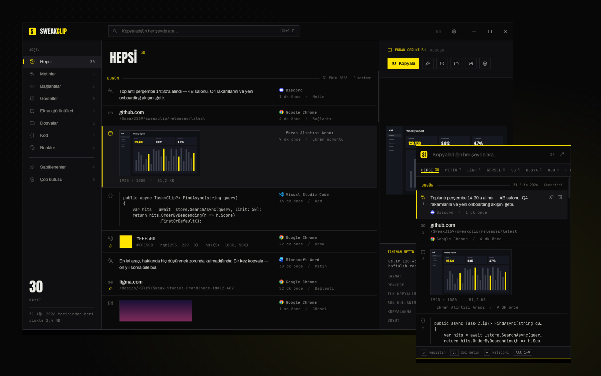
</p>

Windows kopyaladığın son 25 şeyi tutar ve bilgisayarı yeniden başlattığında hepsini siler. **SweaxClip hepsini saklar**: metinler, bağlantılar, kodlar, renkler, görseller, ekran görüntüleri ve dosyalar. Hepsi bilgisayarındaki kalıcı bir arşivde durur; yeniden başlatmalara ve yıllara dayanır. <kbd>Win</kbd> + <kbd>V</kbd>'ye bas, hepsi kategorilere ayrılmış ve aranabilir şekilde karşında.

<br>

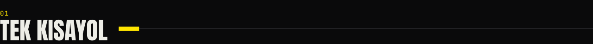

<table>
<tr>
<td width="46%" valign="top">
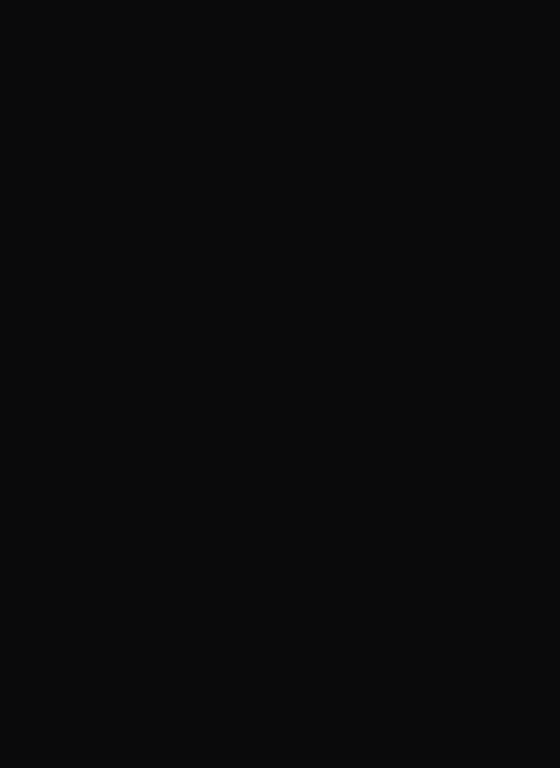
</td>
<td valign="top">

<kbd>Win</kbd> + <kbd>V</kbd> hızlı paneli yazı imlecinin yanında açar; kopyaladığın her şey tek bir zaman çizelgesindedir. Kategoriler bir <kbd>Tab</kbd> uzaklıkta. Seçtiğin şey, yazdığın uygulamaya doğrudan yapıştırılır.

| Tuş | İşlem |
| --- | --- |
| <kbd>Win</kbd> <kbd>V</kbd> | Paneli aç / kapat |
| <kbd>↑</kbd> <kbd>↓</kbd> | Zaman çizelgesinde gez |
| <kbd>Enter</kbd> | Yapıştır |
| <kbd>Shift</kbd> <kbd>Enter</kbd> | Düz metin olarak yapıştır |
| <kbd>Alt</kbd> <kbd>1</kbd>…<kbd>9</kbd> | Numaralı öğeyi yapıştır |
| <kbd>Tab</kbd> · <kbd>←</kbd> <kbd>→</kbd> | Sonraki / önceki kategori |
| <kbd>Ctrl</kbd> <kbd>1</kbd>…<kbd>9</kbd> | Kategoriye atla |
| <kbd>Ctrl</kbd> <kbd>P</kbd> | Sabitle |
| <kbd>Del</kbd> | Çöpe taşı |
| <kbd>Ctrl</kbd> <kbd>C</kbd> | Yapıştırmadan kopyala |
| <kbd>Ctrl</kbd> <kbd>O</kbd> | Bağlantıyı / dosyayı / görseli aç |
| <kbd>Ctrl</kbd> <kbd>E</kbd> | Kütüphanede aç |
| Yazmaya başla | Ara |

</td>
</tr>
</table>

Kısayolu Ayarlar'dan <kbd>Ctrl</kbd> <kbd>Shift</kbd> <kbd>V</kbd> ya da <kbd>Ctrl</kbd> <kbd>Alt</kbd> <kbd>V</kbd> yapabilirsin. `SweaxClip.exe --toggle` paneli her yerden açar: fare tuşu, makro tuşu, Stream Deck.

<br>

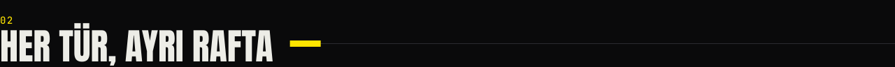

Her kopya geldiği an doğru rafa konur.

<table>
<tr>
<td width="33%">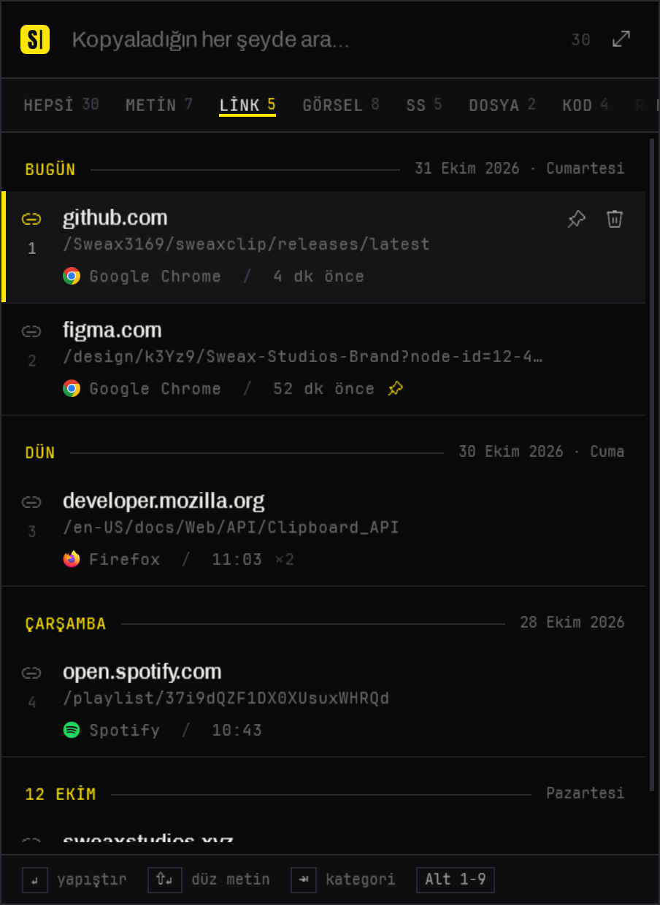</td>
<td width="33%">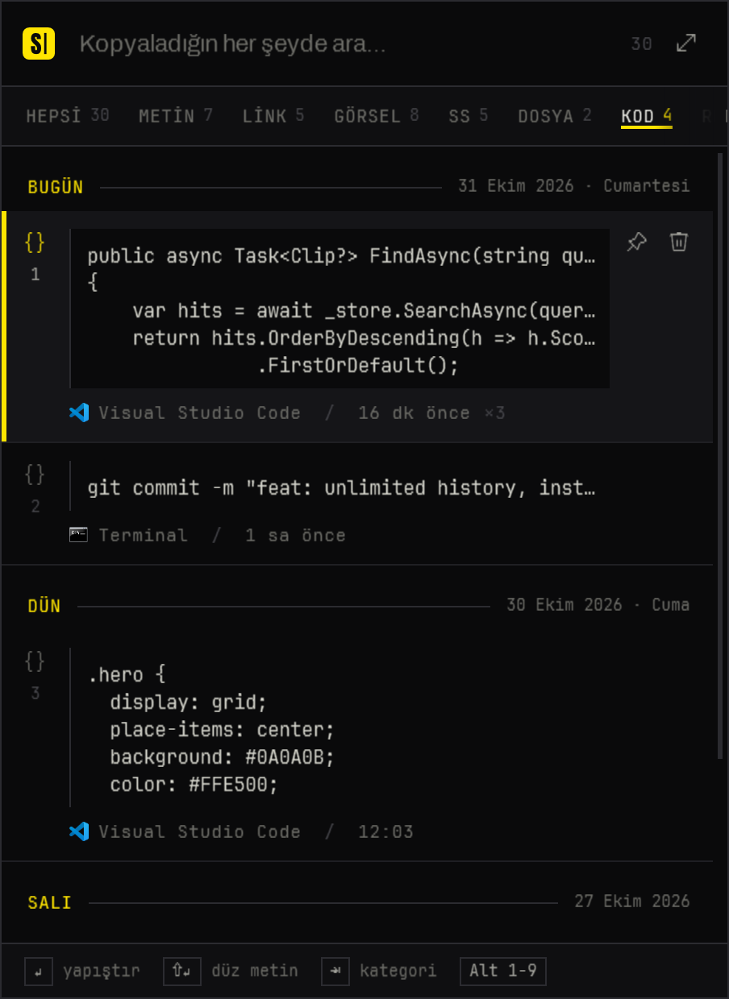</td>
<td width="33%">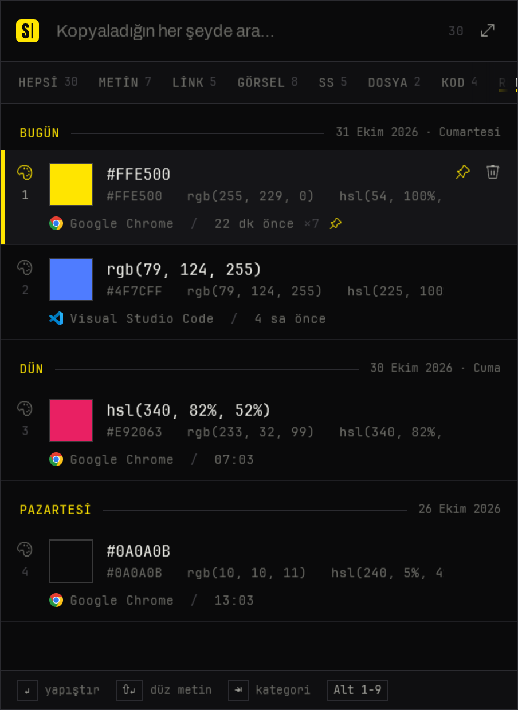</td>
</tr>
</table>

| Kategori | Neler düşer |
| --- | --- |
| **Hepsi** | Tek zaman çizelgesi; en yeni üstte, günlere bölünmüş |
| **Metinler** | Düz ve biçimli metin — Word ve tarayıcı biçimlendirmesi korunur, aynen yapıştırılır |
| **Bağlantılar** | Tek bir URL; alan adı + yol olarak gösterilir, <kbd>Ctrl</kbd> <kbd>O</kbd> açar |
| **Görseller** | Resim olarak kopyalanan her şey, kayıpsız PNG olarak saklanır |
| **Ekran görüntüleri** | Ekran Alıntısı Aracı, <kbd>PrtScn</kbd>, ShareX, Greenshot… ve *Ekran görüntüleri* klasöründeki her şey |
| **Dosyalar** | Dosya Gezgini'nde kopyalanan dosya ve klasörler — yine dosya olarak yapıştırılır |
| **Kod** | Yapısından (süslü parantez, girinti, operatörler) ya da terminal komutlarından tanınır; eşit aralıklı yazıyla gösterilir |
| **Renkler** | `#hex`, `rgb()`, `hsl()` — renk örneği ve tüm dönüşümleriyle |
| **Sabitlenenler** · **Çöp kutusu** | Sakladıkların, ve sen istemedikçe boşalmayan bir çöp kutusu |

Aynı şeyi iki kez kopyalarsan yeni kayıt açılmaz; mevcut kayıt sayacıyla (`×3`) en üste çıkar.

<br>

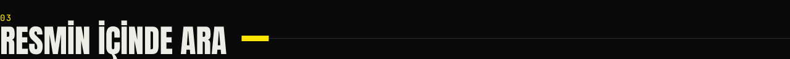

<table>
<tr>
<td width="38%" valign="top">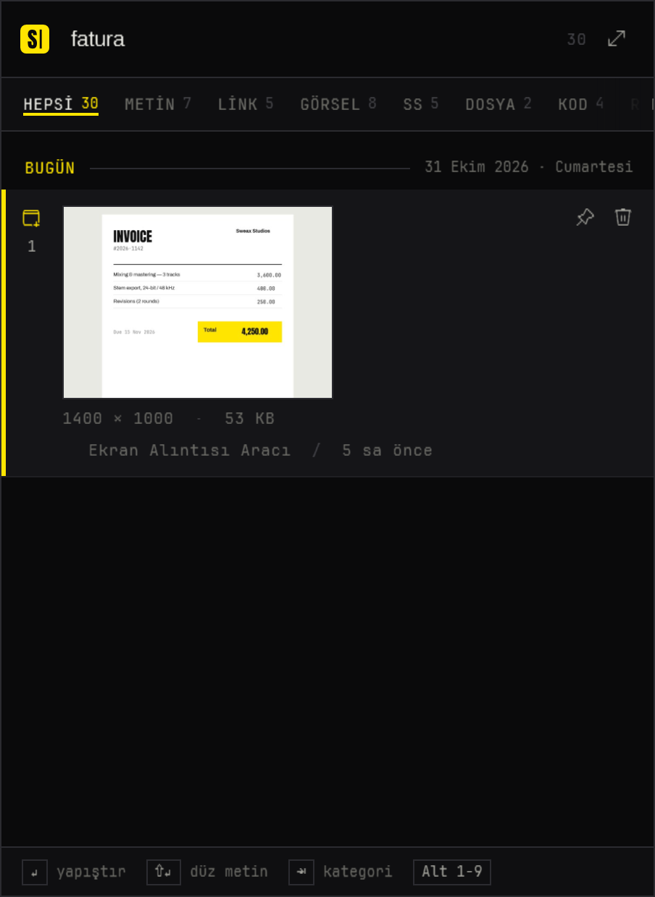</td>
<td valign="top">

Ekran görüntüleri, Windows'un kendi OCR motoruyla, bilgisayarında, arka planda okunur. Bir resmin *içinde* geçen kelimeyi yaz, resim karşına gelsin.

Arama; her kaydın metnini, her görseldeki kelimeleri, kopyalandığı uygulamayı ve pencere başlığını kapsar. Büyük-küçük harfe ve aksanlara takılmaz, Türkçe harfleri bilir: `istanbul` yazınca `İSTANBUL`, `sef` yazınca `Şef` bulunur. Dizin SQLite FTS5 trigram dizini olduğu için kelimenin bir parçası da eşleşir; sonuçlar sen yazarken gelir.

</td>
</tr>
</table>

<br>

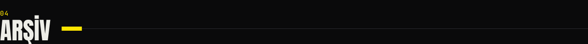

<p align="center">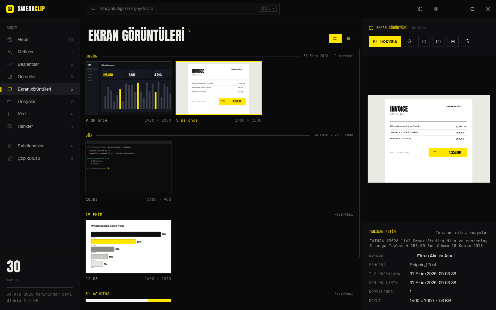</p>

Kütüphaneyi tepsiden (ya da panelde <kbd>Ctrl</kbd> <kbd>E</kbd>) aç: soldaki çubukta tüm kategoriler, görseller kontak baskı düzeninde, sağda ayrıntı paneli. Ayrıntılarda içeriğin tamamı, görseldeki tanınan metin, kaynak uygulama ve pencere, ilk kopyalanma ve son kullanım zamanı, kaç kez kopyalandığı görünür.

<table>
<tr>
<td width="50%">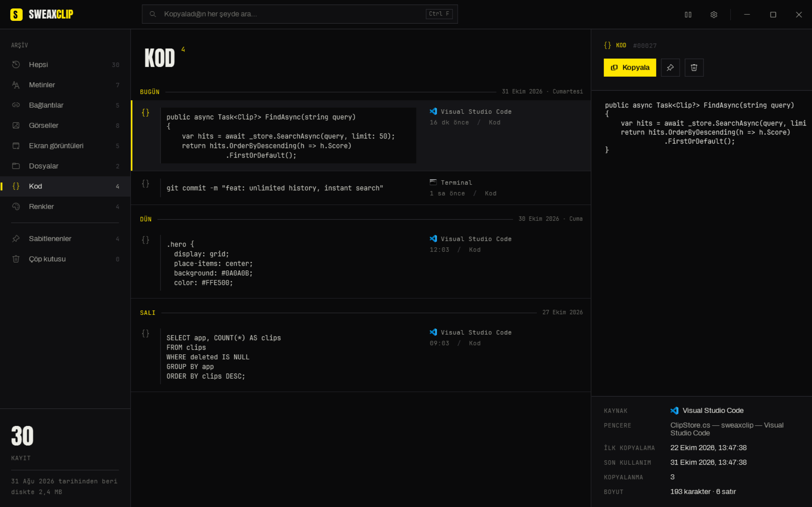</td>
<td width="50%">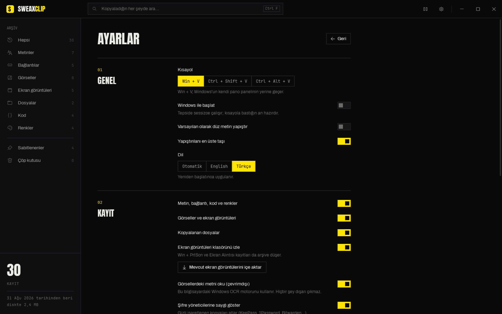</td>
</tr>
</table>

**Neden hiç kaybolmaz**

- **Sınır yok.** Hiçbir şey kendiliğinden silinmez — 25 kayıttan sonra da, 30 günden sonra da, yeniden başlatınca da.
- **Tek veritabanı dosyası** (SQLite, WAL günlüğü, tam senkron yazma) ve SHA-256 özetiyle adlandırılan görsel dosyaları; aynı görsel iki kez saklanmaz.
- **Günlük yedek:** veritabanının son 7 günü ve her aydan bir kopya, süresiz saklanır.
- **Dışa aktar:** Ayarlar'dan bütün arşivi tek bir `.zip` dosyasına al.
- **Taşınabilir mod:** exe'nin yanına boş bir `sweaxclip-data` klasörü koy, arşiv orada tutulsun — USB bellek, eşitlenen bir klasör, başka bir disk.

| | Windows pano geçmişi | SweaxClip |
| --- | :---: | :---: |
| Tutulan kayıt | 25 | Sınırsız |
| Yeniden başlatınca | Silinir (sabitlenenler hariç) | Hepsi kalır |
| Görseller | En fazla 4 MB | Her boyut, kayıpsız |
| Arama | — | Anında, tam metin |
| Ekran görüntüsündeki yazı | — | Çevrimdışı OCR |
| Kategoriler | — | 8 + Sabitlenenler + Çöp |
| Ekran görüntüleri klasörü | — | İçe aktarılır ve izlenir |
| Kopyalanan dosyalar | — | Saklanır, dosya olarak yapıştırılır |
| Yedek / dışa aktarma | — | Günlük yedek, `.zip` |

<br>

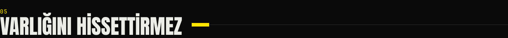

SweaxClip yerel bir .NET / WPF uygulamasıdır, içinde tarayıcı motoru yoktur. Windows 11 (derleme 26200) üzerinde, 266 kayıtlı bir arşivle ölçüldü:

| | |
| --- | --- |
| Tepside beklerken bellek | **≈ 6 MB** çalışma kümesi |
| Beklerken işlemci | **%0** — 15 saniyede 16 ms; hiçbir şeyi yoklamaz |
| Panel açıkken bellek | ≈ 110 MB; panel kapandıktan 2 sn sonra geri verilir |
| Kurulum | tek exe, ayrıca çalışma zamanı kurmak gerekmez |

- Pano, `AddClipboardFormatListener` ile izlenir: Windows, bir şey kopyalandığında SweaxClip'i uyandırır; onun dışında uygulama hiç çalışmaz.
- <kbd>Win</kbd> + <kbd>V</kbd> kancası kendi iş parçacığında, kendi mesaj döngüsüyle çalışır; arayüz meşgul olsa bile Windows kancayı düşürmez. Her 10 dakikada bir ve kilit açıldığında yeniden kurulur.
- Özet alma, PNG kodlama, küçük resimler ve OCR arka planda, sırayla tek tek çalışır.
- Listeler sanallaştırılmıştır; küçük resimler ekranda çizildiği boyutta açılır.

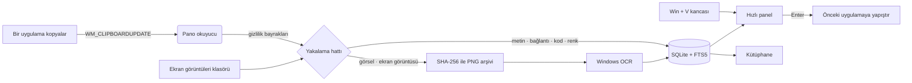

<br>

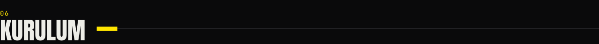

1. [Sürümler](https://github.com/Sweax3169/sweaxclip/releases/latest) sayfasından **`SweaxClip.exe`** dosyasını indir.
2. Çalıştır. Kendini `%LOCALAPPDATA%\Programs\SweaxClip` klasörüne kopyalar, Windows ile başlar, Başlat menüsüne eklenir ve mevcut ekran görüntülerini içe aktarır.
3. <kbd>Win</kbd> + <kbd>V</kbd>'ye bas.

> **"Windows bilgisayarınızı korudu"** uyarısı — exe henüz kod imzalı değil. *Ek bilgi → Yine de çalıştır*'a tıkla. Kaynak kodun tamamı burada; sürüm dosyası bu depodan GitHub Actions ile derlenir.

**Komut satırı**

| | |
| --- | --- |
| `SweaxClip.exe` | Başlat; zaten çalışıyorsa kütüphaneyi aç |
| `SweaxClip.exe --background` | Tepside sessizce başlat (oturum açılışında kullanılır) |
| `SweaxClip.exe --toggle` | Hızlı paneli aç / kapat |
| `SweaxClip.exe --quit` | Çalışan uygulamayı kapat |

**Kaynaktan derleme** — [.NET 9 SDK](https://dotnet.microsoft.com/download/dotnet/9.0) gerekir:

```powershell
git clone https://github.com/Sweax3169/sweaxclip
cd sweaxclip
dotnet run --project src/SweaxClip
# tek dosyalık sürüm
dotnet publish src/SweaxClip -c Release -r win-x64 --self-contained -p:PublishSingleFile=true -o publish
```

`SweaxClip.exe --demo` kütüphaneyi örnek verilerle dolu geçici bir arşivde açar; `--shots <klasör>` bu sayfadaki tüm ekran görüntülerini üretir.

<br>

## Gizlilik

Her şey bilgisayarında kalır. SweaxClip hiçbir ağ isteği yapmaz: hesap yok, telemetri yok, bulut yok. OCR, Windows motoruyla yerelde çalışır.

Uygulamaların gizli olarak işaretlediği kopyalar atlanır — KeePass, KeePassXC, 1Password, Bitwarden ve diğer şifre yöneticileri standart `ExcludeClipboardContentFromMonitorProcessing` / `CanIncludeInClipboardHistory` bayraklarını koyar, SweaxClip bunlara uyar. Ayrıca yok sayılacak uygulamaları listeleyebilir ya da kaydı tepsiden duraklatabilirsin.

Arşiv `%LOCALAPPDATA%\SweaxClip` klasöründedir (`sweaxclip.db`, `blobs\`, `thumbs\`, `backups\`).

## Sık sorulanlar

<details>
<summary><b>Windows'un kendi pano geçmişini kapatıyor mu?</b></summary>
<br>
Hiçbir Windows ayarı değişmez. SweaxClip, <kbd>Win</kbd> + <kbd>V</kbd> tuşunu Windows görmeden önce yakalar. Ayarlar'dan başka bir kısayol seçersen <kbd>Win</kbd> + <kbd>V</kbd> yine Windows'a döner.
</details>

<details>
<summary><b>Arşiv ne kadar yer kaplar?</b></summary>
<br>
Metin küçüktür — on binlerce kayıt, arama dizini dahil onlarca MB tutar. Yeri asıl görseller kaplar; kütüphanenin sol alt köşesi diskteki boyutu gösterir. Gerekmeyenleri sil, çöpü boşalt.
</details>

<details>
<summary><b>Yeni bilgisayara nasıl taşırım?</b></summary>
<br>
Ayarlar → <i>Her şeyi dışa aktar (.zip)</i>, sonra yeni bilgisayarda SweaxClip'i başlatmadan önce zip'i <code>%LOCALAPPDATA%\SweaxClip</code> klasörüne aç.
</details>

<details>
<summary><b>Bazı uygulamalara yapıştırmıyor.</b></summary>
<br>
SweaxClip <kbd>Ctrl</kbd> + <kbd>V</kbd> göndererek yapıştırır. Windows, yönetici olarak çalışan uygulamalara normal bir uygulamanın tuş göndermesine izin vermez; SweaxClip'i de yönetici olarak çalıştır ya da panelde <kbd>Ctrl</kbd> <kbd>C</kbd> ile kopyalayıp kendin yapıştır.
</details>

<details>
<summary><b>Nasıl kaldırırım?</b></summary>
<br>
Tepsi simgesi → <i>SweaxClip'ten çık</i> (istersen önce <i>Windows ile başlat</i>'ı kapat), sonra <code>%LOCALAPPDATA%\Programs\SweaxClip</code> (uygulama) ve <code>%LOCALAPPDATA%\SweaxClip</code> (arşivin) klasörlerini sil.
</details>

## Lisans

[MIT](LICENSE) © 2026 Sweax Studios. Yazı tipleri: Archivo, Anton ve JetBrains Mono, SIL Open Font License ile — bkz. [THIRD_PARTY_NOTICES.md](THIRD_PARTY_NOTICES.md).

<br>

<p align="center">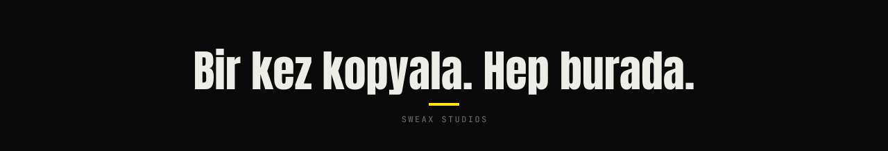</p>
